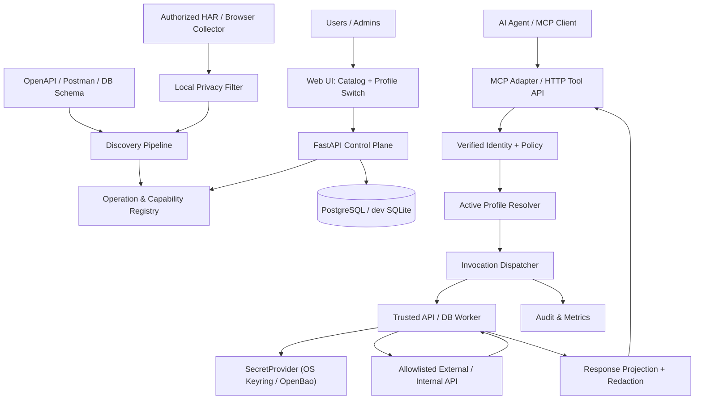

# 02 · 总体架构、模块边界与技术选择

## 1. 架构目标

`pp swich` 同时服务于两类工作流：
- **控制平面**：发现 API、注册服务、创建连接/档案、审核与发布工具、定义权限。
- **执行平面**：按当前用户/Agent 授权解析档案，在受信执行器中取用服务端凭证并访问经过审核的后端。

二者使用同一套稳定的领域模型，但**不能共享密钥读取权限**。

## 2. 逻辑架构



**必须满足的调用闭环**：
`已验证请求身份 → 能力/档案校验 → 策略决策 → 固定执行快照 → 受信 Worker 获取目标专用凭证 → 受限网络调用 → 结构化输出过滤 → 安全审计 → 返回 Agent`

## 3. 六层职责边界

| 层 | 模块 | 允许知道什么 | 不允许做什么 |
|---|---|---|---|
| Collection | HAR Importer / Browser Collector | 用户授权站点的脱敏请求形状 | 无授权全网录制、把 Cookie/密码上报 |
| Discovery | Normalizer / Inferrer | 观察证据、Schema 草稿、置信度 | 自动执行危险请求、自动发布 |
| Registry | Service / Operation / Capability | 无凭证契约、版本、审批状态 | 读取明文密钥 |
| Profile | Connections / Profiles / ActiveBindings | Connection 标识、秘密引用、授权状态 | 解密/导出凭证 |
| Execution | Policy / Dispatcher / Worker / Guard | 授权后的工具参数、固定档案及结果 | 任意 URL、任意 SQL、未授权凭证 |
| Protocol | REST / MCP | 当前 principal 可见的 Tool Schema、脱敏结果 | 公开内部端点或 SecretProvider |

## 4. 重要领域对象

- `Workspace`：个人或组织的隔离单元。MVP 保留个人 workspace；企业版扩展组织成员、角色、审批。
- `Service`：逻辑目标，如 `crm`；与域名、账号分离。
- `Endpoint`：已审查的目标地址，带 prod/stage 环境信息。
- `Operation`：协议级接口，例如 `GET /customers/{customer_id}`。
- `Capability`：对 Agent 可见的语义工具，例如 `crm.get_customer`，绑定 Operation 的固定版本。
- `Connection`：某主体对 Service 的授权连接（只含 `secret_ref`，无明文）。
- `Profile`：Connection + Endpoint 的命名组合，可一键激活。
- `ActiveBinding`：特定用户/工作区/Service/上下文的当前 Profile。
- `Invocation`：带快照的执行请求；切换 Profile 不修改在途请求。
- `Connector`：在不同网络中执行受控能力的 Worker/边缘进程。

## 5. 服务划分：逻辑独立，部署逐步分离

### MVP（推荐）
- `control-api`：FastAPI REST 控制平面 / Registry / Profile；数据库账号**无密钥解密权限**。
- `executor`：独立 Python 进程，接收内部已授权 Invocation；实现 HttpAdapter、MockAdapter、ResponseGuard；是唯一可按策略访问 SecretProvider 的业务进程。
- `mcp-adapter`：MCP 入口；为每个用户过滤 `tools/list` 和 `tools/call`；不得拥有目标 API 凭证。
- `web-console`：React UI；只与控制平面通信。
- `discovery-engine`：HAR/OpenAPI 处理库与异步任务，可先与 `control-api` 同进程运行。

**不要因 MVP 简化而把明文密钥传回 API Controller**。如果为了 demo 共进程，必须标记 `DEV_ONLY_UNSAFE_COLOCATION`，不能作为安全保证或企业生产模式。

### 扩展
- `browser-extension`：MV3 客户端，优先只上传本地已脱敏 Observation。
- `edge-connector`：部署在允许访问目标系统的机器/内网，主动建立安全出站连接。
- `policy-service` / `approval-service`：复杂策略、跨团队审批。
- `nats`/`redis`：有并发需求时异步化，不在最初闭环强制引入。

## 6. 技术路线

| 组件 | 初始选择 | 备选/升级 |
|---|---|---|
| Python 服务 | Python 3.12、FastAPI、Pydantic v2 | 维持 Python SDK 跨环境 |
| ORM / DB | SQLAlchemy 2、Alembic，PostgreSQL | 开发单机 SQLite |
| API HTTP | httpx，关闭自动重定向 | 按明确需求 gRPC / GraphQL |
| MCP | 官方 `modelcontextprotocol/python-sdk` v2 | 独立 Agentgateway/ContextForge |
| UI | React + TypeScript + Vite | 企业 UI 组件库 |
| Collection | DevTools/HAR MVP → Chrome MV3 授权捕获 | mitmproxy 离线辅助（高级模式） |
| 认证 | 本地开发账号/受控 mock，生产 OIDC + JWT audience 校验 | Keycloak/现有 IdP |
| Policy | 明确 RBAC + scoped ABAC 的 Python 模块 | OPA（规则复杂时） |
| Vault | Mock → OS Keyring（个人）/ OpenBao（企业） | 各云 KMS |
| Trace | 结构化日志 + OTel | 企业监控平台 |

**依赖管理**：选择时先验证 MCP 官方 SDK 与当前规范的支持矩阵；将 SDK 版本固定在 lockfile；不手写整套 MCP 认证协议。

## 7. 部署拓扑

### A. 个人本地
`localhost UI + control-api + executor + SQLite + OS Keyring`，只监听 `127.0.0.1`，不能被外网访问。可选 MCP stdio 本地客户端，或带来源校验/认证的本地 HTTP。

### B. 中小团队
`Reverse proxy + control-api + mcp-adapter + PostgreSQL + executor + OpenBao`，全链路 TLS，执行器独立身份，禁止公网直连控制数据库和 Vault。

### C. 多内网/混合云
中央控制平面管理目录，`edge-connector` 驻留目标网络；连接器**只主动发起** mTLS 通信；服务端下发结构化、已批准调用，不下发任意 Shell 或 URL；SecretProvider 可以按区域或客户隔离。

## 8. 控制/执行分离的接口原则

控制面仅创建已经验证、签名或防篡改的任务描述；执行面还应独立校验权限、Endpoint 和任务有效期。网络上不能因为“消息来自内部网”就盲信。

任务至少有：`invocation_id`、`capability_version_id`、`principal_claims`（签发与时效校验）、`profile_snapshot_id`、`arguments_digest`、`policy_version`、`deadline` 和一次性重放保护标识。

需要对受信任服务签名的身份/调用凭证进行 audience 校验；不通过客户端可控 JSON 直接指定 `credential_ref`。

## 9. 设计中的四个不可混淆点

1. `MCP Token` ≠ `Downstream API Token`：二者受众必须独立，不允许透传。
2. `Discovered` ≠ `Executable`：抓包推断的接口可能依赖 Cookie、CSRF、动态签名或权限。
3. `Shared Definition` ≠ `Shared Credentials`：API 可共享，账号授权需单独获得。
4. `Switched Profile` ≠ `Browser Account Switched`：切换受控 API 凭证绑定，不劫持网页会话。

## 10. 可扩展性约定

所有协议实现依赖抽象 `CapabilityInvocationService`，而不是直接让 `mcp-adapter` 了解 HTTP 端点细节。

```
ProtocolAdapter (MCP, REST)
    → CapabilityInvocationService
        → AuthZ
        → ActiveBindingResolver
        → Executor
            → TransportAdapter (HTTP/DB/mock)
            → SecretProvider
            → ResponseGuard
```

未来更换底层 REST 接口、网络拓扑、MCP 版本时，Agent 的能力名和输入输出契约尽量保持不变。
