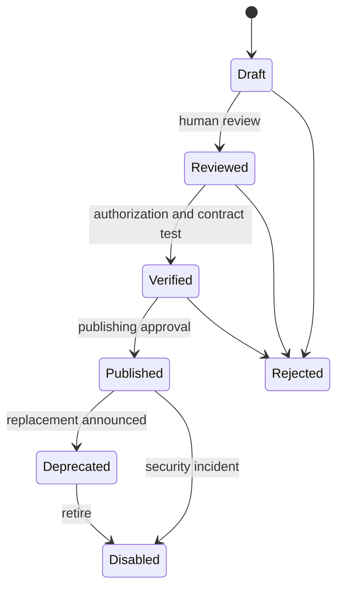

# 04 · 统一 Capability 契约、Profile Switch 与工具发布状态机

## 1. 核心定义

| 对象 | 含义 |
|---|---|
| `Service` | 逻辑系统，例如某个 CRM，可能有多个 Endpoint |
| `Endpoint` | 经管理员批准的目标地址、环境、允许方法/路径/出口策略 |
| `Observation` | 脱敏后的 API 行为线索 |
| `Operation` | 方法+路径+参数+响应的接口契约 |
| `Capability` | 面向 Agent 的语义业务能力，绑定审核过的 Operation |
| `Connection` | 用户/工作负载对某服务的授权，服务端持有 secret ref |
| `Profile` | Endpoint + Connection + 标签 + 策略上下文 |
| `ActiveBinding` | 用户/Agent/部署上下文中当前选择的 Profile |
| `Invocation` | 对固定 Capability Version 和 Profile 快照的一次调用 |

关键原则：**Operation 是协议契约，Capability 是有业务语义和权限的工具契约。**

## 2. 稳定命名

- 能力名 `namespace.operation`：例如 `crm.get_customer`、`llm.chat`；
- 内部主键 UUID（由应用生成）；人类可读标识不得作为唯一可信身份；
- 版本 `1.0.0`；发布过的版本禁止原位修改；
- Endpoint/账号不写入 Capability 名称；
- 协议适配层负责转换符合具体 MCP 客户端的工具名。

## 3. YAML 内部能力规范

```yaml
apiVersion: pp-switch.dev/v1
kind: Capability
metadata:
  name: crm.get_customer
  version: 1.0.0
  displayName: Get customer
  ownerWorkspace: demo
spec:
  description: Get a customer within the caller's authorized scope
  visibility: private
  riskLevel: low
  operationRef:
    service: crm
    operation: getCustomer
    contractVersion: 1
  inputSchema:
    type: object
    additionalProperties: false
    required: [customer_id]
    properties:
      customer_id:
        type: string
        minLength: 1
        maxLength: 64
  outputSchema:
    type: object
    additionalProperties: false
    required: [id, display_name]
    properties:
      id: {type: string}
      display_name: {type: string}
  execution:
    transport: http
    adapterRef: crm-http-adapter-v1
    endpointPolicyRef: crm-approved-endpoints
    maxDurationMs: 10000
    maxResponseBytes: 65536
    idempotent: true
    retries: 0
  authorization:
    userScopes: [crm.customer.read]
    agentScopes: [crm.customer.read]
    objectPolicy: assigned_or_owned_customer
    approvalPolicy: none
  response:
    allowFields: [id, display_name]
    includeRawHeaders: false
    redactSecrets: true
  publishing:
    reviewRequired: true
    verifiedEvidenceRequired: true
```

这是**内部发布契约**：`adapterRef`、`endpointPolicyRef`、内部域名、Credential Binding 不向模型导出。

### 对 Agent 的公共工具视图

```json
{
  "name": "crm_get_customer",
  "description": "Get a customer you are authorized to view.",
  "inputSchema": {
    "type": "object",
    "properties": {
      "customer_id": {"type": "string", "maxLength": 64}
    },
    "required": ["customer_id"],
    "additionalProperties": false
  }
}
```

Tool Schema 只包含经过人工审核的描述、业务参数；不包含 URL、API Key、Cookie、`secret_ref`。

## 4. Profile = Connection + Endpoint

### Connection

```json
{
  "connection_id": "con-001",
  "service_id": "svc-crm",
  "owner_principal_id": "user-001",
  "auth_scheme": "oauth2",
  "status": "active",
  "scopes": ["customer.read"],
  "secret_configured": true
}
```

`secret_ref` 属于内部字段；所有公开 API 只显示 `secret_configured` 这样的状态。

### Profile

```json
{
  "profile_id": "prof-001",
  "service_id": "svc-crm",
  "endpoint_id": "ep-staging",
  "connection_id": "con-001",
  "display_name": "CRM / Staging / My account",
  "status": "enabled"
}
```

必须验证：Endpoint 和 Connection 属于同一 Service，用户对二者有权，Connection 未过期且可执行。

### ActiveBinding

逻辑唯一键：
`workspace_id + principal_id + service_id + context_key`。

包括：
- `active_profile_id`
- `version`（整数乐观锁）
- `updated_at`
- `updated_by`

允许的 `context_key`：`personal`、`agent:<verified-id>`、`deployment:<verified-id>`。这些上下文必须根据已核验身份和授权决定，不能由模型声称自己是某 Agent。

**Profile 一键 Switch 改变的是下次调用选择的档案；执行中 Invocation 使用已经冻结的 Profile Snapshot。**

## 5. 能力生命周期



- 未发布版不得进入生产 MCP `tools/list`；
- 低风险只读也需要输出白名单和资源级权限；
- 发布版本哈希和审核 ID 固定，任何更改都生成新版本；
- 关闭 Capability 不清除审计与历史版本；
- AI 生成的说明是草稿，不是自动发布授权。

## 6. 内部 Invocation 契约

```json
{
  "invocation_id": "inv-001",
  "capability_version_id": "capv-001",
  "principal": {
    "verified_user_id": "user-001",
    "verified_agent_id": "agent-001",
    "workspace_id": "workspace-001"
  },
  "profile_snapshot_id": "snapshot-001",
  "arguments": {"customer_id": "C-1024"},
  "arguments_digest": "sha256-over-canonical-data",
  "policy_version": "policy-v1",
  "deadline_at": "2026-10-13T10:00:10Z"
}
```

这是一份**内部示意**；示例 ID 和摘要并非真实编码格式。`principal` 必须由受信赖网关生成，执行器须检查其真实性、audience、有效期和权限。绝不能直接信任客户端传入的 principal 字段。

## 7. 执行原则

- 输入：按已批准 JSON Schema 严格验证 `additionalProperties:false`。
- 路由：固定 Operation + Endpoint + Method；目标 URL 不由模型控制。
- 凭证：受信 Executor 从 SecretProvider 获取，MCP/HTTP 公共客户端看不到。
- 输出：字段 allowlist、类型验证、大小限制、敏感信息抑制、异常规范化。
- 预算：每用户/Agent/能力限频和高风险审批。
- 写入：明确幂等键和审批；请求超时后不能自动重复执行。
- 审计：保存版本、actor、档案与策略的非秘密快照。

## 8. 新系统接入建议：OpenAPI + 自定义扩展

系统开发者可发布 OpenAPI 3.1 并附加：
```yaml
x-pp-switch:
  capability: crm.get_customer
  display-name: Get customer
  category: crm
  risk-level: low
  object-scope: customer.assigned
  idempotent: true
  data-classification: internal
```

扩展只是审批线索，不会代替后端的身份认证与授权决策。没有扩展元数据的普通 OpenAPI 接口仍然可以导入并审核。
