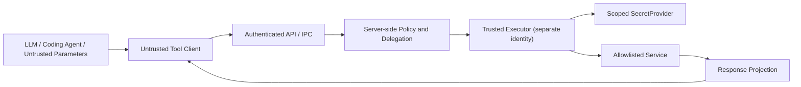

# 05 · 安全架构、密钥隔离与威胁模型

## 0. 安全承诺的准确表述

目标是：**pp switch 的正常工具描述、模型请求和工具结果中不出现后端 API Key、用户密码、OAuth Token、Cookie、私钥或可恢复秘密材料**。必须通过设计隔离与自动化测试验证，而不是靠模型系统提示词。外部模型仍可能收到经授权的**业务结果数据**，须独立制定数据最小化和外发策略。

**不作“绝对安全”“零知识”宣传**。如果持有访问权的 Executor 被完全攻陷，其有权使用的凭证可能泄漏；利用最小权限、短期凭证、主机与身份隔离来限制影响范围。

新增最高优先级安全目标：**AI 编码助手不必读取项目 `.env` 就可以编写/测试代码；生产真实密钥不保存在它有权读取的文件或进程环境中。**

## 1. 信任边界和威胁模型



### 数据分级

| 级别 | 数据 | 默认策略 |
|---|---|---|
| PublicTool | Tool 名称、可公开说明、输入 Schema | 按权限对 Agent 发布 |
| UserData | 查询结果、业务字段 | 最小化后才允许发送模型 |
| Internal | 内网 Host、调用绑定、审计、策略 | 仅信任服务可见 |
| Secret | 密码、API Key、Token、Cookie、签名私钥、数据库密码 | 禁止进入模型、普通日志和发现记录 |
| SensitiveDiscovery | HAR、真实 URL、Headers、Query、错误体、GraphQL variables | 本地清洗；禁止直接使用原始数据做模型上下文 |

注意：**别名是非秘密标识，但某些内部服务名仍属于敏感元数据**，也应控制可见范围。

## 2. 每次工具调用的授权链

1. 验证调用者身份和凭据受众、有效期、撤销状态。
2. 在可信服务端生成 `principal`，确定 `user / agent / workspace / delegated scopes`。
3. 只加载该 principal 有权看到的已发布 `CapabilityVersion`。
4. 解析当前 `ActiveProfile`，检查所属人、服务、连接权限、环境与端点策略。
5. 求授权交集：`UserScope ∩ AgentScope ∩ DelegationScope ∩ ResourceScope ∩ EndpointPolicy`。
6. 服务端 JSON Schema 校验，不接收任意 URL、Authorization Header 或 SecretRef。
7. 生成不可变执行快照；高风险操作必须通过绑定参数摘要的可信审批。
8. 隔离的 Executor 用自己的工作负载身份访问**目标特定的** SecretProvider。
9. 再次检查目标地址、DNS/IP、证书、重定向、输出大小与 Content-Type。
10. 将后端响应做**字段白名单投影**，只把获批输出返回模型。
11. 审计 `request_id / actor / decision / policy_version / duration`，默认不保存请求/响应全文。

策略不可用、Profile 被撤销、凭证不可用或 Endpoint 意外跳转时，必须**默认拒绝**。

## 3. `.env` 凭证防护：两种方案的区别

### A. 安全首选：**Secretless API Invocation（不返回秘密）**

代码里只写：
```python
from ppswitch import PPSwitchClient

client = PPSwitchClient.from_local_broker()  # SDK 未来接口；非现成实现
result = client.invoke(
    capability="crm.search_customers",
    arguments={"keyword": "acme"},
)
```

后台绑定：
`capability alias → active profile → authorized connection → SecretProvider → target API → response guard`。

**客户端和 AI 编码助手从未获取目标服务的原始凭证。** 但它们仍可能以被允许的身份发起操作，所以生产数据访问必须通过独立授权、沙箱和预算。

### B. 兼容方案：运行时解密并注入环境变量

例如 `pp-switch run -- python app.py` 将 Token 放入子进程环境，旧 SDK 可直接使用。

**它不满足强安全目标**：同一权限域中的 AI 编码助手可以通过进程环境、debug、日志或运行代码取得 Token。最多提供迁移便利，应标记 `LEGACY_INJECTION_UNSAFE`，默认关闭，不允许开发 Agent 使用生产凭证。

**不准把 `PP_API_KEY=pp://secrets/prod` 解释为“随时可以通过公共 get-secret 接口取出明文”**。这种方案只是移动了密码位置，没有阻止泄漏。

详细接口和迁移流程见 [18-SECRETLESS-DEVELOPMENT](18-SECRETLESS-DEVELOPMENT.md)。

## 4. SecretProvider / 工作负载认证

### 开发

- 仅使用 mock Service、虚构账号和合成蜜罐值。
- 本地可信运行时可用 OS Keyring / OS 安全存储，必须验证不同 OS 的隔离能力。
- `MockSecretProvider` 永远不能访问生产 Endpoint。

### 企业生产

- OpenBao / KMS / HSM 等成熟实现；不要自己写可逆加密算法。
- Control API 和 Registry 仅能访问 `secret_ref` 元数据，**无读取/解密权限**。
- Executor 通过工作负载身份获取最小权限、短期凭证；不同业务域/租户独立身份。
- OpenBao AppRole 的 `SecretID` 本身也是秘密：**不能把它放到项目 `.env`**。优先使用机器/工作负载身份、受控安装引导或短期证书，通过操作系统/部署平台安全提供。
- 撤销或轮换凭证时清除可用缓存，并审查仍在运行的 Invocation。
- OAuth 授权用 Authorization Code + PKCE；Token 不向模型透传。
- 传入 MCP Server 的访问 Token 不能当成后端授权 Token 使用。

### 开发 Agent 与真实应用必须不同权限

| 主体 | 可以做 | 不可以做 |
|---|---|---|
| AI Coding Agent | 读源码、运行无生产凭证的测试、调用 mock 工具 | 访问真实 SecretProvider、生产 Connector、生产网络 |
| 普通开发者 | 使用经审批的开发档案执行低风险接口 | 读取其他用户秘密、调用生产高风险操作 |
| 正式应用进程 | 经工作负载认证、在策略范围内调用 Capability | 明文导出秘密 |
| Executor | 用自身身份获取指定目标所需的凭证 | 访问无关服务凭证、任意网络目的地 |
| 管理员 | 建立/撤销连接、审批权限、查看脱敏审计 | 从普通管理 API 导出所有明文 Token |

如果 AI Coding Agent 与正式应用进程以**同一 OS 身份、同一容器、相同网络权限**执行任意代码，则不能保证它无法滥用正式应用的调用能力。必须使用独立 OS 用户、容器/VM 沙箱或远程受控执行器，限制 socket、凭证和生产网络访问。

## 5. SSRF、目标地址、重定向

- 不提供公开的通用任意 URL HTTP Proxy；所有目标来自审批过的 `Endpoint`。
- 端点检查 scheme、域名、端口、路径模板和允许请求方法，拒绝 URL 用户信息部分。
- 外网 Worker 默认拒绝 loopback、链路本地、云元数据 IP、私有 IP；**内网 Connector 可为经审批私网段建立独立策略**，不能全局拒绝内部系统。
- 解析 DNS 后对每个 IP 验证，连接前固定/校验实际目标 IP，防 DNS Rebinding。
- 不自动跨主机重定向；建议 httpx `follow_redirects=False`。
- 限制超时、响应体大小、并发、请求体大小、TLS CA/证书验证；不要禁用 TLS 验证。
- 遵循企业出站代理和防火墙限制；网络 ACL 与应用检查双保险。

## 6. STRIDE 与具体测试

| 攻击 | 防护 | P0 测试 |
|---|---|---|
| 模型伪造 user_id 或 tenant_id | principal 仅由受信身份服务提供 | JSON 加 `user_id` 被拒 |
| 跨用户 Profile 劫用 | owner + delegation 授权检查 | 用户 B 无法激活 A 私有档案 |
| HAR 内藏 Token | 本地删除 + 服务端二次清洗 | 入库/日志无蜜罐 |
| API 返回 `Set-Cookie` / Token | 输出 Schema + Header 剥离 | 模型工具结果无蜜罐 |
| 任意 URL → 内网元数据 | 无通用目标，网络 allowlist | 拒绝 169.254.169.254 |
| 模型发起高风险写入 | 审批、幂等、资源权限 | 无签署批准即拒绝 |
| Agent 读取 `.env` | 仓库无真实秘密；隔离生产身份 | agent 沙箱无生产 socket / egress |
| Agent 修改代码偷数据 | 与生产运行时隔离；授权与审计 | 修改代码仍不能使用生产身份 |
| 恶意工具描述诱导操作 | 描述审核、固定工具版本 | 插入 prompt injection 不升权 |
| 目标 API 数据量过大 | 分页、配额、脱敏、限制输出 | 超预算时强制失败 |

## 7. 运维安全控制

- HTTPS/mTLS、会话管理、CSRF/Origin 保护、CORS 精准配置。
- 后台登陆强制 MFA（高风险操作）；敏感操作用二次确认。
- 可插拔 SecretProvider，密钥来源与工作负载身份必须可审计。
- `.gitignore`、Agent 工具忽略规则、secret scanner 作为多重防护；它们**不能代替 OS 权限隔离**。
- CI：依赖锁定、许可证扫描、SBOM、Secret Scanning、SAST、容器扫描。
- 日志禁止记录 `Authorization`、`Cookie`、`SecretRef` 值、完整响应体与原始 HAR。
- 明确规定生产 `get_secret`/`export_secret` API **不存在**；密钥只用于受控执行。
- 审批日志、审计索引可查询，但不包含原文凭证。
- 任何密钥泄漏事件须执行撤销、轮换、调查、通知与回归测试流程。

## 8. 参考资料

- OWASP [Secure Coding with AI Cheat Sheet](https://cheatsheetseries.owasp.org/cheatsheets/Secure_Coding_with_AI_Cheat_Sheet.html)；
- OWASP [MCP Security Cheat Sheet](https://cheatsheetseries.owasp.org/cheatsheets/MCP_Security_Cheat_Sheet.html)；
- OpenBao [AppRole auth](https://openbao.org/docs/auth/approle/)；
- MCP [Authorization](https://modelcontextprotocol.io/specification/)；
- 更完整的威胁与迁移细节：[18-SECRETLESS-DEVELOPMENT](18-SECRETLESS-DEVELOPMENT.md)。
