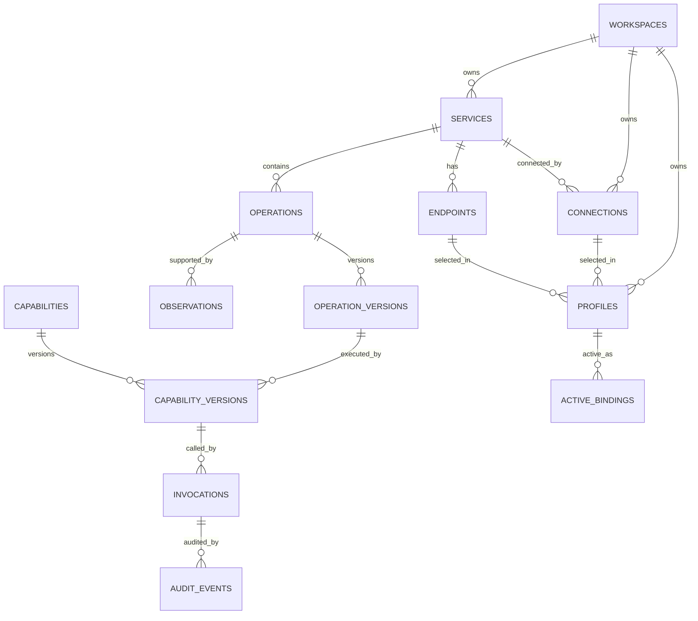

# 06 · 数据模型、ERD、PostgreSQL DDL 与数据治理

## 1. 数据建模原则

- `Service ≠ Endpoint ≠ Operation ≠ Capability`：避免把一个 URL 等同于一个可给 Agent 调用的工具。
- `Connection ≠ Profile ≠ ActiveBinding`：账号授权、命名环境配置与一键切换状态是不同实体。
- 观察数据、契约、发布能力、实际授权和执行记录必须分离。
- 共享 API **不等于**共享凭证；`credential_ref` 是受控引用，不存明文。
- 所有业务记录必须有可检验的 `workspace_id` 归属或继承有效归属。
- 发布版本不可变；历史 Invocation 绑定明确版本和 Profile 快照。

## 2. 领域 ERD



## 3. 核心表清单

| 表 | 主键 | 主要字段 |
|---|---|---|
| `workspaces` | id | slug, name, kind, created_at |
| `workspace_members` | workspace_id, principal_id | role, status |
| `services` | id | workspace_id, slug, visibility, owner_principal_id |
| `endpoints` | id | service_id, environment, base_url, approved_hosts, status |
| `observations` | id | workspace_id, service_id, source, normalized_shape, redaction_version, expires_at |
| `operations` | id | service_id, method, normalized_path, fingerprint, status |
| `operation_versions` | id | operation_id, version, input_schema, output_schema, contract_hash |
| `capabilities` | id | workspace_id, namespace, name, visibility, status |
| `capability_versions` | id | capability_id, operation_version_id, version, policy_ref, projection_schema, status |
| `connections` | id | workspace_id, service_id, owner_principal_id, secret_ref, auth_scheme, status |
| `profiles` | id | workspace_id, service_id, endpoint_id, connection_id, owner_principal_id, name, status |
| `active_bindings` | scope key | workspace_id, principal_id, context_key, service_id, profile_id, version |
| `agent_grants` | id | workspace_id, agent_id, capability_id, scopes, expires_at |
| `invocations` | id | workspace_id, capability_version_id, profile_snapshot, actor, arguments_digest, status |
| `approvals` | id | invocation_id, approver_id, argument_digest, expires_at, status |
| `audit_events` | id | workspace_id, invocation_id, actor_id, action, decision, redacted_metadata |

`users` / `principals` 可以来自 OIDC IdP；数据库首期只保留最小本地主体映射表，正式部署不复制原始密码。

## 4. PostgreSQL 起步迁移（可作为 Alembic 逻辑参考）

> 以下 SQL 是**部分核心结构的可运行形状参考**，不是完整企业 schema。外键的跨 workspace/service 一致性、RLS、审计保留、批准事件、Endpoint egress 校验仍须在后续迁移和应用层补齐。UUID 由应用生成。

```sql
CREATE TABLE workspaces (
    id UUID PRIMARY KEY,
    slug TEXT NOT NULL UNIQUE,
    name TEXT NOT NULL,
    kind TEXT NOT NULL CHECK (kind IN ('personal', 'organization')),
    created_at TIMESTAMPTZ NOT NULL DEFAULT now()
);

CREATE TABLE services (
    id UUID PRIMARY KEY,
    workspace_id UUID NOT NULL REFERENCES workspaces(id),
    slug TEXT NOT NULL,
    name TEXT NOT NULL,
    visibility TEXT NOT NULL DEFAULT 'private'
      CHECK (visibility IN ('private', 'team', 'organization')),
    owner_principal_id TEXT NOT NULL,
    created_at TIMESTAMPTZ NOT NULL DEFAULT now(),
    UNIQUE (workspace_id, slug),
    UNIQUE (id, workspace_id)
);

CREATE TABLE endpoints (
    id UUID PRIMARY KEY,
    workspace_id UUID NOT NULL,
    service_id UUID NOT NULL,
    environment TEXT NOT NULL,
    base_url TEXT NOT NULL,
    approved_hosts JSONB NOT NULL DEFAULT '[]'::jsonb,
    status TEXT NOT NULL DEFAULT 'pending'
      CHECK (status IN ('pending', 'approved', 'disabled')),
    FOREIGN KEY (service_id, workspace_id)
      REFERENCES services(id, workspace_id),
    UNIQUE (id, service_id),
    UNIQUE (service_id, environment, base_url)
);

CREATE TABLE operations (
    id UUID PRIMARY KEY,
    workspace_id UUID NOT NULL,
    service_id UUID NOT NULL,
    method TEXT NOT NULL,
    normalized_path TEXT NOT NULL,
    fingerprint TEXT NOT NULL,
    status TEXT NOT NULL DEFAULT 'observed'
      CHECK (status IN ('observed', 'inferred', 'needs_review',
                        'verified', 'rejected')),
    FOREIGN KEY (service_id, workspace_id)
      REFERENCES services(id, workspace_id),
    UNIQUE (service_id, fingerprint),
    UNIQUE (id, service_id)
);

CREATE TABLE operation_versions (
    id UUID PRIMARY KEY,
    operation_id UUID NOT NULL REFERENCES operations(id),
    version INTEGER NOT NULL CHECK (version > 0),
    input_schema JSONB NOT NULL,
    output_schema JSONB NOT NULL,
    contract_hash TEXT NOT NULL,
    created_at TIMESTAMPTZ NOT NULL DEFAULT now(),
    UNIQUE (operation_id, version)
);

CREATE TABLE capabilities (
    id UUID PRIMARY KEY,
    workspace_id UUID NOT NULL REFERENCES workspaces(id),
    name TEXT NOT NULL,
    visibility TEXT NOT NULL DEFAULT 'private'
      CHECK (visibility IN ('private', 'team', 'organization')),
    status TEXT NOT NULL DEFAULT 'draft'
      CHECK (status IN ('draft', 'reviewed', 'verified',
                        'published', 'deprecated', 'disabled')),
    UNIQUE (workspace_id, name),
    UNIQUE (id, workspace_id)
);

CREATE TABLE capability_versions (
    id UUID PRIMARY KEY,
    capability_id UUID NOT NULL REFERENCES capabilities(id),
    operation_version_id UUID NOT NULL REFERENCES operation_versions(id),
    version TEXT NOT NULL,
    risk_level TEXT NOT NULL
      CHECK (risk_level IN ('low', 'medium', 'high', 'critical')),
    input_schema JSONB NOT NULL,
    output_schema JSONB NOT NULL,
    policy_ref TEXT NOT NULL,
    published_at TIMESTAMPTZ,
    content_hash TEXT NOT NULL,
    UNIQUE (capability_id, version)
);

CREATE TABLE connections (
    id UUID PRIMARY KEY,
    workspace_id UUID NOT NULL,
    service_id UUID NOT NULL,
    owner_principal_id TEXT NOT NULL,
    auth_scheme TEXT NOT NULL,
    secret_ref TEXT,
    status TEXT NOT NULL DEFAULT 'pending'
      CHECK (status IN ('pending', 'active', 'expired', 'revoked')),
    FOREIGN KEY (service_id, workspace_id)
      REFERENCES services(id, workspace_id),
    UNIQUE (id, service_id)
);

CREATE TABLE profiles (
    id UUID PRIMARY KEY,
    workspace_id UUID NOT NULL,
    service_id UUID NOT NULL,
    endpoint_id UUID NOT NULL,
    connection_id UUID NOT NULL,
    owner_principal_id TEXT NOT NULL,
    name TEXT NOT NULL,
    status TEXT NOT NULL DEFAULT 'enabled'
      CHECK (status IN ('enabled', 'disabled')),
    FOREIGN KEY (service_id, workspace_id)
      REFERENCES services(id, workspace_id),
    FOREIGN KEY (endpoint_id, service_id)
      REFERENCES endpoints(id, service_id),
    FOREIGN KEY (connection_id, service_id)
      REFERENCES connections(id, service_id),
    UNIQUE (workspace_id, owner_principal_id, service_id, name)
);

CREATE TABLE active_bindings (
    workspace_id UUID NOT NULL REFERENCES workspaces(id),
    principal_id TEXT NOT NULL,
    service_id UUID NOT NULL,
    context_key TEXT NOT NULL,
    profile_id UUID NOT NULL REFERENCES profiles(id),
    version BIGINT NOT NULL DEFAULT 1 CHECK (version > 0),
    updated_at TIMESTAMPTZ NOT NULL DEFAULT now(),
    PRIMARY KEY (workspace_id, principal_id, service_id, context_key)
);

CREATE TABLE invocations (
    id UUID PRIMARY KEY,
    workspace_id UUID NOT NULL REFERENCES workspaces(id),
    capability_version_id UUID NOT NULL REFERENCES capability_versions(id),
    principal_id TEXT NOT NULL,
    agent_id TEXT,
    profile_id UUID NOT NULL REFERENCES profiles(id),
    profile_snapshot JSONB NOT NULL,
    arguments_digest TEXT NOT NULL,
    idempotency_key TEXT,
    policy_version TEXT NOT NULL,
    status TEXT NOT NULL,
    created_at TIMESTAMPTZ NOT NULL DEFAULT now(),
    finished_at TIMESTAMPTZ,
    UNIQUE (workspace_id, idempotency_key)
);
```

**关于 SQL 约束：**
- `UNIQUE(workspace_id, idempotency_key)` 在 PostgreSQL 默认允许多条 `NULL`，符合无幂等键请求的初步行为，但幂等键的过期与作用域还需具体设计。
- `active_bindings.profile_id` 目前仅保证存在，尚未在 SQL 层保证 `workspace / owner / service` 全部匹配：生产必须增加复合外键或经过审计的数据库约束/触发器，并配套权限测试。
- `operation_versions` 与 `capabilities` 的 workspace 归属链需要 DB 校验和服务端强制校验。
- 发布版本不可变不仅靠应用约定，应限制 SQL 更新权限或引入不可变版本触发器。
- 单机 SQLite 的 CHECK/JSON/外键支持与 PostgreSQL 不完全一致；测试与迁移应验证差异。

## 5. 推荐索引

```sql
CREATE INDEX idx_services_workspace
  ON services (workspace_id, slug);

CREATE INDEX idx_operations_service_status
  ON operations (service_id, status);

CREATE INDEX idx_invocations_workspace_time
  ON invocations (workspace_id, created_at DESC);

CREATE INDEX idx_invocations_agent_time
  ON invocations (agent_id, created_at DESC)
  WHERE agent_id IS NOT NULL;
```

高频 API 观察记录建议按时间分区、按 TTL 删除；审计记录采用专用存储和保留策略。未经审核的观察数据不可永久保留。

## 6. 配置存储与密钥引用

`connections.secret_ref` 示例：
```
secretprovider://openbao/workspaces/W1/services/crm/connections/C1
```

**数据库中的 secret_ref 本身也属于内部敏感元数据**：不得通过 `GET /connections` 返回原文；UI 只展示 `configured: true`、认证类型、最后验证时间和可用状态。`secret_ref` 不包含真实密码，不应当是任何用户都可兑换秘密的公开票据。

## 7. API 去重与版本管理

- `observations` 只存脱敏的 `normalized_shape`、来源、样本数及保留期限。
- `operations.fingerprint` 范围只在同一 `service_id` 内唯一。
- `operation_versions` 保存不可变 Schema：不同观察产生变更候选时创建新版本。
- `capability_versions` 绑定固定 `operation_version_id`，不受 API Discovery 后续推断影响。
- 旧接口断开时，可以改用新 Operation Version 并发布新 Capability Version，而不破坏其他工具。

## 8. 多租户与访问控制

- 对外 API 的每次查询必须由已验证 principal 注入 workspace 范围。
- 生产 PostgreSQL 建议启用并测试 RLS，应用使用不具有 `BYPASSRLS` 权限的数据库角色。
- RLS 不能替代应用层跨服务、跨 Profile 校验，尤其跨表 join。
- 内部操作只能使用有权限的服务角色，禁止所有组件共用 DB 超级用户。
- 敏感字段使用视图/投影，避免把连接表直接暴露给 API 目录。
- 组织管理员审批/审计权不等同于读取用户私有连接的明文秘密。

## 9. 并发 Profile 切换

通过乐观锁防止客户端状态覆盖：
```sql
UPDATE active_bindings
SET profile_id = :new_profile_id,
    version = version + 1,
    updated_at = now()
WHERE workspace_id = :workspace_id
  AND principal_id = :principal_id
  AND service_id = :service_id
  AND context_key = :context_key
  AND version = :expected_version
RETURNING version;
```

若更新 0 行，返回 `409 PROFILE_VERSION_CONFLICT`。新建首次绑定用 `INSERT ... ON CONFLICT`，按服务端规则检查 Profile 所有权与权限。执行链在事务中读取绑定，形成不可变快照后再下发 Worker。

## 10. 数据保留与迁移策略

- API Observation：默认建议 30 天、可配置；保留归纳 Schema 和聚合指标。
- Invocation：按组织审计需求分类保留，默认仅保留结构化元数据。
- 审批：保留审批人、内容摘要、时间戳与策略版本，严禁明文密钥。
- 数据迁移：Alembic migration 前向版本化；生产执行前备份、演练回滚；包含 schema version 校验。
