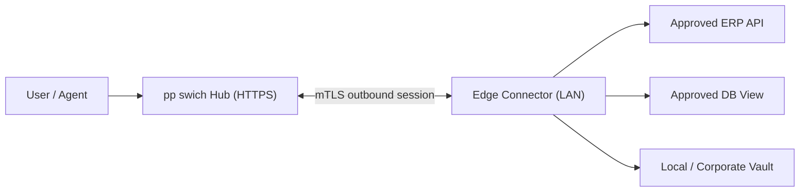

# 10 · 本机、Docker、内网及企业部署方案

## 1. 部署目标

部署方式**不绑定 K8s**，同一套 Capability / Profile / Execution 契约适用于：
- 单机 localhost（个人工具和开发）；
- 一台服务器/VM + Docker Compose；
- 多台内网服务器（中央控制面 + 本地 Edge Connector）；
- 公有云 / 企业 K8s（进阶，但非默认前提）。

## 2. 四种形态

### 2.1 本机个人模式（首期）

组件：
- FastAPI Control（127.0.0.1）；
- SQLite（本地）；
- Web Console；
- Local Broker / Executor（独立 OS 进程，推荐不同服务身份）；
- Mock / OS Keyring SecretProvider（仅被信任的本机用户/服务访问）。

适用：个人授权 API、演示、单一用户；SQLite 不适合多节点并发企业部署。

**重点限制**：本机所有进程如果同一 UID 且 AI Agent 可执行任意代码，就不能把普通 0600 socket 当成强秘密隔离。要保护生产凭证，应选择远程受信 Worker、不同 OS 身份或隔离 VM/容器。

### 2.2 Docker Compose 团队模式

目标服务清单（待实现）：
```
reverse-proxy      TLS termination / OIDC callback
web-console        React static assets
control-api        FastAPI Registry / Profile / Policy
mcp-adapter        MCP transport / tool visibility
executor           Restricted API adapter workers
postgres           Metadata + audit index
openbao            SecretProvider (enterprise mode)
```

网络：
- `frontend`：仅 reverse-proxy 可从外部访问；
- `backend`：control / executor / postgres / openbao 内部通信；
- `egress`：Executor 只能访问获批目标；真实阻断需宿主机防火墙和网络出口代理配合；
- DB 和 OpenBao 不对公网暴露。

启动顺序：先 DB + Vault，再迁移，再 Control/Executor，最后 Web/MCP。正式部署必须有 Backup/Restore、TLS、OIDC、审计和秘密引导流程。

### 2.3 多服务器内网



- Connector 从内网**主动建立**安全连接；Hub 不必知道内部拓扑细节；
- 每个 Connector 声明已批准的 Service/Endpoint 和处理范围；
- 任务不包含任意 Shell、任意网络目标或完整凭证；
- 多个私有网络可以部署多个 Connector，分区域策略和 secret providers；
- 不建议把内网服务通过 FRP/NAT 任意映射到公网。

### 2.4 K8s / Cloud

采用既有技术进行部署：
- namespace / NetworkPolicy / service identity / Pod Security；
- KMS 或 OpenBao 以及工作负载认证；
- OIDC、可观察性、HPA（可选）；
- 禁止把全权 Vault Token 放在环境变量中；
- 通过 CNI/出口代理落实真实网络 allowlist。

## 3. 启动配置规范

项目配置文件：
```yaml
project: sample-crm
workspace: demo
bindings:
  crm:
    capability_namespace: crm
    profile: crm-dev
runtime:
  broker: local
  http_timeout_seconds: 10
```

`*.example`、`pp-swich.example.yaml` 可以进 Git；**真实 OAuth Client Secret、OpenBao SecretID、客户 API Key 均不可提交**。

生产组件需要的密钥/bootstrap authentication 由 OS/KMS/secret store/受信安装步骤提供，而不是放进开发项目的 `.env`。

## 4. 健康检查与端口

- `GET /healthz`：进程活性，不能泄漏依赖拓扑；
- `GET /readyz`：数据库/关键依赖就绪（认证或内网可见）；
- 仅 Control 和公开 MCP/HTTP 入口允许通过反向代理访问；
- Executor 内部接口必须有独立服务认证；
- 本地 broker 优先通过 Unix Socket / Windows Named Pipe 而不是裸露的任意 TCP 端口；
- 默认 CORS deny，按需配置安全的 Origin allowlist。

## 5. 数据与密钥备份

- DB 备份：加密、分工作区的最小恢复权限、保留期限，演练恢复。
- SecretProvider 备份：遵循对应产品的解封/备份流程，密钥材料与备份分离。
- 不建议备份未经脱敏原始 HAR；Observation 记录有 TTL。
- 备份文件不可被 AI 代码代理或普通 Git 工作目录读取。
- 密钥轮换后要确认旧的 Profile 是否继续使用已撤销令牌。

## 6. 上线前配置检查表

- [ ] 外部访问使用可信 TLS 证书和严格重定向；
- [ ] 企业身份/登录流配置 MFA、session policy、CSRF；
- [ ] 数据库账号非超级用户；隔离读写与迁移角色；
- [ ] Control / Executor 进程身份不同且能证明；
- [ ] SecretProvider 权限按租户/系统细分；
- [ ] 私网/外网 egress 规则经测试，不能任意访问内部服务；
- [ ] MCP Authorization 与 OAuth audience 验证；
- [ ] 日志、错误、Trace 的脱敏集成测试通过；
- [ ] 备份恢复和事件响应演练完成；
- [ ] 生产秘密不在 `.env` / git / CI stdout / Agent workspace 中；
- [ ] 非幂等写操作具备审批与重复执行保护。

## 7. 降级行为

- Vault/Keyring 不可访问 → 返回 `SECRET_PROVIDER_UNAVAILABLE`；不回退环境变量。
- 选中 Profile 失效 → 明确显示错误，不能静默切换另一个账号。
- Connection 被撤销 → 拒绝新请求，清理授权缓存。
- MCP 入口断开 → 不应重试已经执行成功但回复失败的写操作。
- 中央 Hub 与 Edge 失联 → Worker 暂停新任务并保护本地秘密；不要执行过期任务。
