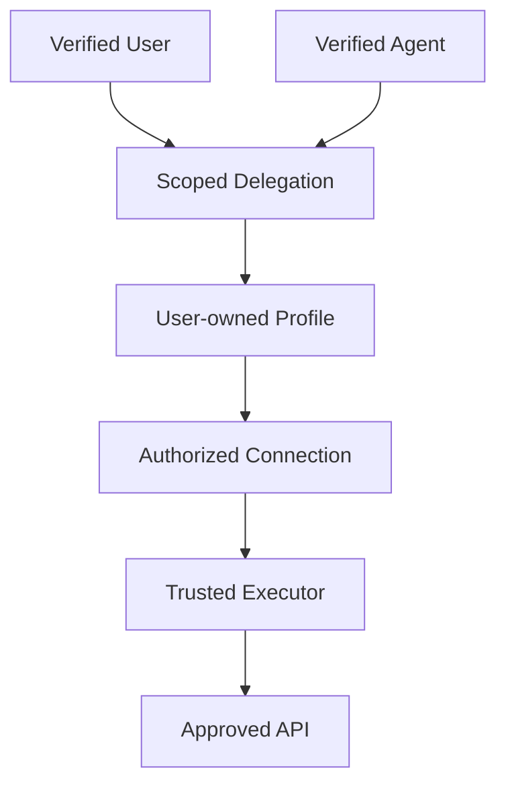
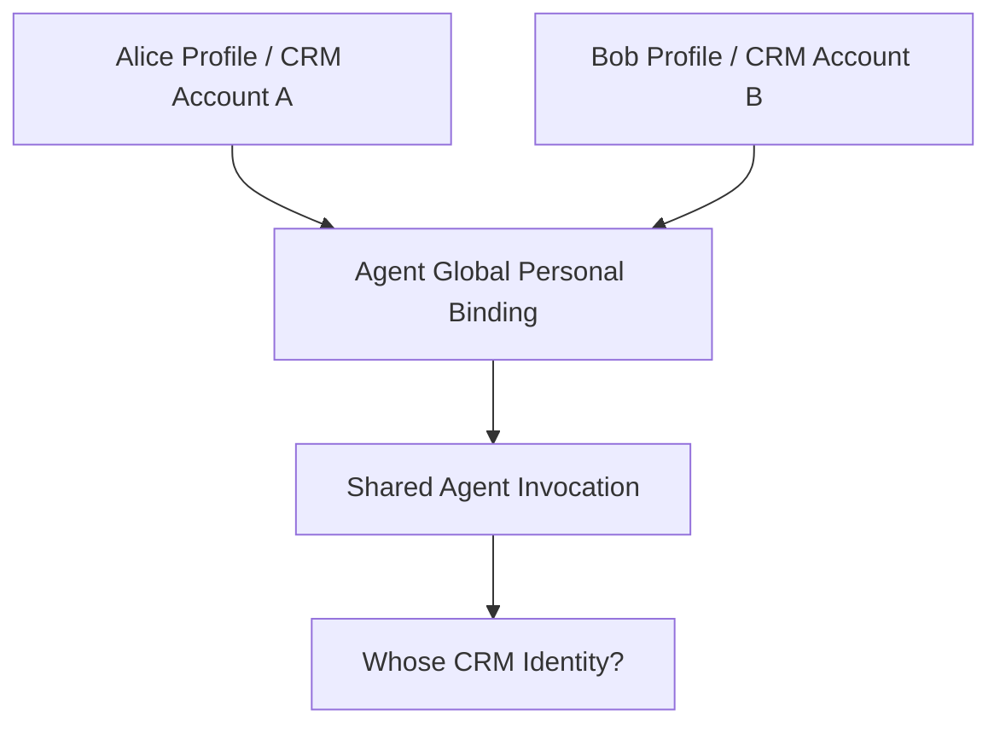
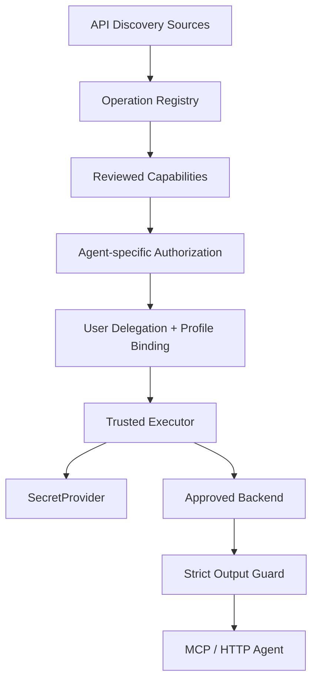
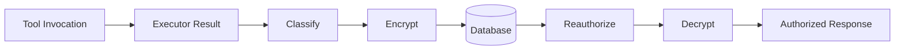

# 历史助手正式评审原文摘录

说明：以下正文为提供的历史对话文件中相应 assistant 回合的**完整实质性回复**，保留当时判断、局限和日期措辞，不代表交接时重新验证。其中 round 7 的旧产品拼写也原样保留。


---

# 历史 round 7 · 审批/评审原文

# pp swich v0.1.0 项目技术评审

(Pre-alpha 首个闭环：有条件通过) (真实凭证与企业生产部署：暂不批准)

我已经阅读了你提供的 ，并进一步检查了公开仓库中的控制平面、执行器、HTTP Adapter、权限处理、Profile 切换、MCP 适配及测试配置。

**我的总体判断是：pp swich 已经从一套设计文档发展成了有真实代码支撑的架构原型，技术路线值得继续投入。但现阶段还不能作为企业正式的 API 密钥保险库。**

值得肯定的是，你没有把项目做成一个简单的 API Key 管理界面，而是已经建立了几个非常重要的边界：

- API 发现结果与正式发布的 Agent Capability 分离。
- Connection、Profile、Endpoint 和 Capability 分别建模。
- 凭证在受信任执行器中解析，而不是作为工具参数传给模型。
- Profile 切换具备乐观锁和调用快照语义。
- MCP 和 HTTP 复用同一条执行链路。
- 有自动化安全测试，且 README 明确将项目标为 Pre-alpha。

不过，深入查看实现后，我认为**除了报告主动列出的 9 项偏差，还需要额外处理几项更重要的授权和执行边界问题**。这些问题对单人 Mock 演示的影响有限，但对你希望服务的多用户、企业和 Agent 场景影响很大。

本次评审以公开仓库 `main` 分支的代码及报告所述 `e42e40a` 实现基线为依据。由于当前环境无法直接克隆仓库并启动多服务，我会严格区分源码确认的问题、静态分析识别的风险以及报告宣称但尚未独立复跑的验收结果。

## 一、源码审查发现：需要新增的安全问题

这一部分比原报告的 9 项设计偏差更紧急。

风险等级：P0 = 接入真实凭证或多人部署前必须修复；P1 = 下一阶段应完成。以下属于源码静态审查发现，尚未全部执行攻击复现。

### 1\. P0：Profile 创建时没有校验 Connection 的所有权

这是我发现的最需要优先修复的问题。

涉及代码：

`apps/control-api/src/ppswich_control/services/connection_service.py`

在 `create_profile()` 中，你验证了 Service、Endpoint、Connection 是否属于同一个 Workspace 和 Service，但没有校验：

```python
connection.owner_principal_id == principal_id
```

而 `validate_profile_alignment()` 也只检查 Service 和 Workspace 对齐。与此同时，`GET /connections` 会返回工作区内的连接 ID，创建 Endpoint 的接口允许认证用户直接提交 `status="approved"`。

这意味着在同一 Workspace 内，存在以下潜在越权组合：

潜在风险路径（需要集成验证）

用户 A 创建 Connection，未来绑定真实凭证

用户 B 获取同工作区 Connection ID

用户 B 将 A 的 Connection 与自己创建的 Endpoint 组成 Profile

用户 B 激活 Profile，并触发受信执行器

可能越权使用 A 的后端凭证，甚至向非预期端点发送凭证

当前 Mock Provider 不等于真实凭证系统，因此不能据此宣称已经在生产环境完成了密钥窃取。但一旦接入 OpenBao，这条路径会变得危险。

**修复要求：** 创建、激活和执行三个阶段都要核验 Connection 所有权或有效的显式委托。Endpoint 必须由具有相应审批权限的主体批准，不能让普通创建者自行批准任意目标。

### 2\. P0：Agent 可能自行获得工具授权

涉及：

`apps/control-api/src/ppswich_control/api/v1/router.py` 的 `create_agent_grant()`。

目前接口通过 `require_principal` 确认调用者身份，再检查目标 Agent 和 Capability 属于当前 Workspace，但没有对调用者实施管理员角色或授权授予权限检查。

因此，从这段路由实现看，拥有有效 Agent 凭据的调用者也可以尝试给自己创建 `AgentGrant`。

这和产品的“Agent 不得自行提权”原则冲突。

还要同步修正 `review`、`verify`、`publish` 端点：目前状态机确保调用顺序正确，却没有确保审核人具有审核资格。创建人可以在当前权限模型下完成整条发布流程。

**建议：** 引入操作级服务端权限，例如 `capability.review`、`capability.publish`、`agent.grant.manage`、`endpoint.approve`，并默认禁止 Agent 身份调用管理类 API。状态机和角色授权必须同时成立。

### 3\. P0：高风险操作的审批仍存在绕过空间

你已经做了 `approvals` 表、参数摘要和一次性消费，这个方向是正确的。但有两处具体问题。

第一，审批接口只在“调用者是 user 且与请求人相同”时禁止自批。依照目前代码，Agent 身份未被同样阻止，也没有审批人角色白名单。

第二，执行时只检查审批记录的 Workspace、状态和 `arguments_digest`，没有同时绑定原始请求人、Capability Version、Profile、资源和有效期。不同高风险操作如果参数摘要相同，存在审批凭据被交叉使用的风险。

**我的要求是：**

审批必须绑定一个不可变 Proposal，包括 `requester_id + capability_version_id + profile_id + normalized_arguments_digest + resource_scope + expires_at`。执行时全部核验，审批人必须是可信人类身份或经特别授权的外部审批系统；仅凭 Agent 请求不能批准。

### 4\. P0：幂等键可能造成同工作区的数据越权读取

`invocation_service.py` 的幂等判断发生在正常的 Capability 授权检查之前。

查询条件只有：

```python
InvocationRow.workspace_id == workspace_id
InvocationRow.idempotency_key == idempotency_key
```

如果找到记录，就直接返回原执行结果，没有核对 `principal_id`、Capability、参数摘要和执行档案。

在多人 Workspace 中，这不仅是幂等冲突问题，也可能成为数据泄露路径。

修复方式是把幂等记录绑定到经过授权的请求主体与操作契约。相同 Key、相同主体、相同规范化请求可以返回缓存结果；相同 Key 但主体或参数不符必须拒绝，而不是返回别人的结果。

此外，`GET /invocations` 和 `GET /invocations/{id}` 目前只按 Workspace 过滤，也需要增加结果所有权或审计角色授权。

### 5\. P0：URL 组装和网络目标校验还不够严格

这是我在执行器侧发现的另一项关键问题。

`HttpAdapter._build_url()` 使用 `str(value)` 直接替换路径占位符。执行器先对原始路径模板执行网络检查，再将实际参数填入 URL 发起请求。

例如，概念上发布的是：

```text
GET /api/customers/{customer_id}
```

如果字段只要求字符串，却不约束其作为 URL Path Segment 的格式，那么带有路径分隔符或 `..` 的参数可能改变最终请求路径。通过本地 HTTPX URL 解析验证，`/api/customers/../../admin` 会被规范化为 `/admin`。

另外，`network_policy.py` 当前把 `approved_hosts` 用作私有地址的例外条件，却没有对所有公网目标强制执行主机白名单匹配。

这两处都应该修复。

**建议同时实施：** 动态路径参数按 Segment 编码、约束路径字符、最终 URL 再验证、精确 Host/Port 白名单、DNS 解析结果与实际连接地址绑定，并对云元数据等特殊目标保留不可覆盖的拒绝规则。

### 6\. P0：Response Guard 的深层字段保护不足

目前 `project_response()` 只针对顶层字段执行 `allow_fields` 选择，然后通过正则处理部分疑似秘密字符串。它没有使用 `output_schema` 对嵌套对象执行严格的递归字段投影。

例如：

```json
{
  "customer": {
    "name": "Alice",
    "api_key": "ordinary-secret-value"
  }
}
```

如果允许输出整个 `customer` 对象，嵌套的 `api_key` 可能保留，因为其值不一定匹配当前的敏感字符串正则。

这直接关系到你的核心承诺。

**应改为基于已审核输出 Schema 的递归白名单投影**，并对所有层级实施敏感字段拒绝、类型检查、长度与深度限制。正则脱敏只能做最后的补充防护，不能承担主要安全职责。

---

## 二、还有两个架构层面的隐患

**Agent 缺少真实的用户委托上下文。** 当前 Agent 执行主要依据 Agent Principal、AgentGrant 和 Agent 自己的活动绑定，没有建立完整的 `user × agent × connection × resource` 授权交集；`AgentGrant.scopes` 和 `Connection.scopes` 也尚未真正参与策略计算。对于多人共用 Agent 的场景，这会让“Agent 到底代表谁执行”变得不明确。

**控制平面的执行记录保存范围偏大。** `profile_snapshot` 当前保存完整 Invocation Plan，包含 `arguments`、`secret_ref`、目标地址等内部信息。虽然这不是把明文密码存进数据库，但依然可能包含业务敏感参数，也不符合设计文档提出的“默认不保存请求全文”原则。建议分离执行期短暂使用的 Plan 与长期保存的脱敏审计快照。

以上发现并不意味着第一版应当推倒重来。恰恰相反，这些风险多数发生在几个清晰的授权边界上，适合通过集中修改 Policy、Connection、Approval、Executor 和测试来修复，无需更换整体架构。

## 三、对报告第 5 节：9 项实现偏差的正式审核

以下是我给出的逐项审核决定。这里区分“实现方式可接受”与“目前代码已经达到安全要求”，两者不是一回事。

| 偏差 | 审核意见 | 处理建议 |
|--------|--------|--------|
| D-1 Multipart 同步导入 | (有条件批准) | MVP 没必要引入独立上传服务。需要限制实际读取大小和解析复杂度，未来批量导入再异步化 |
| D-2 新增 review / verify 接口 | (设计批准) | 明确需要审核角色，审核证据应绑定不可变契约版本 |
| D-3 Dev 账号目录免鉴权 | (必须收紧) | Demo 默认关闭，只允许明确启用的隔离本地环境，不能仅依靠“合成 Token”作为安全理由 |
| D-4 Mock 凭证确定性派生 | (批准 Mock 用途) | 可以长期保留作为测试实现，但绝不能扩展到真实凭证或生产网络 |
| D-5 Agent 档案绑定语义 | (当前不批准) | 必须重新设计用户、Agent、Connection 之间的委托关系 |
| D-6 显式审批流 | (架构批准，代码待修) | 保留审批表和一次性消费机制，补充审批角色、绑定范围、过期及并发原子性 |
| D-7 复合外键 | (批准) | 这是值得保留的改进；另需数据库层约束 Connection 所有权关系 |
| D-8 内部 Token + HMAC | (仅批准开发环境) | 演示可继续使用，生产必须采用独立身份与密钥、TLS/mTLS、密钥轮换和安全启动校验 |
| D-9 MCP 工具目录静态注册 | (MVP 可暂缓) | 不阻塞下一轮开发，但正式多用户使用前必须支持按身份过滤与刷新 |

以上九项偏差描述与送审报告一致。

### 我特别想强调 D-5

当前的 `agent:<id>` 映射到 Agent 自身 `personal` 绑定，在单个用户拥有一个 Agent 的 Demo 中确实很简单。

但如果将来张三和李四同时使用一个公司客服 Agent，就会出现一个问题：

**这个 Agent 的 personal 到底代表谁的账号？**

如果绑定是 Agent 全局共享的，则不同用户可能覆盖同一个活动档案。这与“每个人都能一键切换自己的账号，并允许自己的 Agent 使用”这一产品目标冲突。

建议未来的委托身份至少包含以下关系：



实际执行应同时满足用户拥有 Connection、Agent 获得明确授权、Capability 被允许、资源范围符合策略，而不是只给 Agent 一份全局连接。

我建议在这次评审中正式作出一个架构决定：

**Agent 本身不拥有用户凭证，Agent 通过有时效、可撤销、绑定具体资源范围的 Delegation 使用用户的 Connection。**

这个模型越早确定，后续修改数据库、MCP Session 和 Profile UI 的代价越低。

---

## 四、对报告第 8 节：6 个问题直接拍板

| 报告问题 | 最终决定 |
|--------|--------|
| Q1：Multipart 直传能否成为 v0.1 标准？ | **可以。** 保留现有接口，读取时采用最大长度约束，补充内容类型、结构深度、导入成本限制。 |
| Q2：免鉴权 Dev 目录是否可接受？ | **仅隔离演示可接受。** 默认关闭 Demo，使用显式启用开关和本机监听限制。仅限制 `127.0.0.1` 不足以替代部署安全。 |
| Q3：确定性 Mock Provider 能否长期保留？ | **可以。** 只保留在 `MockSecretProvider`，明确禁止它处理真实生产凭证或未经限定的真实目标。 |
| Q4：Agent personal 映射是否符合原设计？ | **不符合多用户场景的完整意图。** 应引入用户与 Agent 之间的显式 Delegation，并使绑定按用户隔离。 |
| Q5：缺少 MCP 目录刷新是否阻塞？ | **不阻塞 Pre-alpha 下一迭代。** 但多用户正式接入前要支持按权限动态列工具、失效刷新与变更通知。 |
| Q6：DNS IP 钉扎是否为下一轮 P0？ | **是。** 与最终 URL 校验、严格 Host 白名单、路径参数安全一起进入 P0。 |

这里对 Q5 再补充一项实际发现：`registry.py` 当前仅按 Published 状态过滤，HTTP 的 `list_capabilities` 也主要按照 Workspace 查询。尚未确保 MCP `tools/list` 只返回这个 Agent 获得授权的工具。

所以 D-9 不应仅被理解为“热刷新功能”，更需要同时完成工具发现阶段的权限过滤。

---

## 五、第 3–4 节验收证据的可信度

我核查到了实际的 GitHub Actions 执行记录。

**CI：`e42e40a`**

Ubuntu / Windows、前端构建

(Success)


---

**Security gates：`5686b90`**

仓库扫描与 P0 测试矩阵

(Success)


两个工作流的成功状态可以从 GitHub 页面确认，工作流源码也确实配置了 Ruff、mypy、pytest、前端 TypeScript 构建和安全扫描。

因此，我认可“具备自动化验证流程”这一事实。

但需要对证据分级：

| 验收项 | 审核结论 |
|--------|--------|
| 122 项测试 | 报告声明且 CI 成功；未独立重新计数和复跑 |
| 10 个首竖切场景 | 测试覆盖有明确对应描述，可以作为开发态验收基础 |
| 18/20 P0 安全覆盖 | 只表示原有测试矩阵覆盖，不代表没有新的漏洞 |
| Windows / Ubuntu CI | 已确认有两个系统的测试任务 |
| PostgreSQL | 尚无 PG 集成 CI，不认可企业数据库验收完成 |
| 真实 SecretProvider | 未实现，不能进行真实密钥安全验收 |
| 企业多用户安全 | 存在前述跨用户授权风险，暂未通过 |
| 实际模型请求无秘密 | 已有架构性防护，但尚不能对任意嵌套响应作完整保证 |

还有一点需要调整测试理念：

**安全测试应从“验证已有保护措施”转向“验证攻击者能否组合多个合法 API 达到非法效果”。**

例如，测试“不能激活别人创建的 Profile”是不够的。还需要测试“能否创建一个新的 Profile，绑定别人的 Connection”。

类似地，测试“Agent 没有 Grant 会被拒绝”也不够；还必须测试“Agent 能否自行创建 Grant”。

这种组合式测试非常适合 pp swich，因为你最终做的是安全能力网关，而不是普通 CRUD 平台。

---

## 六、下一轮开发，我建议调整优先级

报告第 9 节提出优先推进 E5 MCP 刷新、E6 浏览器 Collector、E7 OpenBao。

我的意见是：**先完成安全边界修复，再把真实凭证接进系统。浏览器 Collector 可以稍后开发。**

建议拆成如下 PR，直接作为 GitHub Issues 的开发顺序。

**PR-SEC-01 · 授权与 Connection 所有权**

(P0)

对 Service、Endpoint、Connection、Profile、Capability 和 AgentGrant 引入操作级权限；阻止跨用户组合 Connection；禁止 Agent 自我授权。补充 User-Agent Delegation 契约。

---

**PR-SEC-02 · 审批与幂等安全**

(P0)

审批记录绑定请求人、工具版本、资源、参数、期限和可信审批主体。幂等键增加 Principal、Capability 和参数摘要校验，并处理并发消费。

---

**PR-SEC-03 · HTTP Executor 出口加固**

(P0)

修复路径拼装、最终目标校验、DNS IP 钉扎、地址白名单和云元数据访问。使用流式读取限制后端响应体大小。

---

**PR-SEC-04 · 输出与审计数据安全**

(P0)

用 Output Schema 递归白名单代替顶层字段筛选；执行记录不持久保存完整 Plan 和敏感参数；查询 Invocation 结果需验证所有权。

---

**PR-SEC-05 · Demo / Production 强隔离**

(P0)

默认关闭 Demo，禁止生产使用默认内部 Token、Mock Provider 和免鉴权登录目录。生产配置不完整时拒绝启动，而不是使用开发默认值。

---

**PR-QA-06 · 独立安全回归与 PostgreSQL CI**

(P1)

在 PostgreSQL 中验证事务、并发、外键及迁移；增加新的攻击组合测试、依赖漏洞扫描、日志泄露测试和安全基线检查。

---

**PR-FEAT-07 · 真实身份和凭证管理**

(P1 · 安全修复后)

实现 OS Keyring 或 OpenBao Provider、OIDC/JWT Audience、连接授权与撤销、凭证轮换。只允许通过受控执行器使用密钥。

---

**PR-FEAT-08 · API 自动归集和工具协议扩展**

(P2)

推进 Chrome MV3 Collector、数据库 Discovery、API Contract Drift、MCP 动态目录与变更通知，让系统向真正的通用工具平台演进。

### 下一轮必须新增的回归测试

| 测试编号 | 必须满足的断言 |
|--------|--------|
| SEC-021 | 用户 B 不能创建引用用户 A 私有 Connection 的 Profile |
| SEC-022 | Agent 不能通过管理 API 给自己授予 Capability |
| SEC-023 | Agent 不能批准自己的高风险 Invocation |
| SEC-024 | 一个审批凭据不能批准其他工具、其他资源或其他请求人 |
| SEC-025 | 同 Workspace 不同 Principal 使用相同幂等键不能得到对方结果 |
| SEC-026 | 带路径分隔符、路径回退或编码异常的参数不能改变批准的操作路径 |
| SEC-027 | 未在批准目标列表中的公网、私网和元数据地址均按策略被拒绝 |
| SEC-028 | 已批准的嵌套对象不能泄露普通字符串形式的 `api_key`、`token` 等秘密 |
| SEC-029 | 同 Workspace 的用户不能未经授权查看他人的执行结果 |
| SEC-030 | 非 Demo 模式不能启用开发身份目录、Mock 凭证或默认内部认证材料 |

以上这些测试不需要正式企业系统，可以全部使用合成账号、Mock Vault 和本地测试服务完成。

---

## 七、从产品发展角度，我给 pp swich 的建议

现在还有一个比技术实现更重要的取舍。

你最初的构想包含两个方向：

**第一个方向是开发者密钥与 API Profile 管理。** 让开发者一键切换不同账号、不同 Endpoint、不同环境，同时防止 AI 编码 Agent 读取真实 API Key。

**第二个方向是企业级 API 能力网络。** 让团队持续发现各类系统 API，归集为可审核、可授权、可供 Agent 使用的共享工具。

两个方向完全可以共存，但我建议采用不同的成熟度目标。

| 版本 | 核心交付 | 目标用户 |
|--------|--------|--------|
| v0.1 当前 | Mock 闭环与架构验证 | 项目开发者 |
| v0.2 | 修复 P0、严格本地隔离、真实凭证存储与一键切换 | 单机开发者、早期贡献者 |
| v0.3 | API / 数据库导入、MCP 工具动态管理、真实 API 执行 | 个人 Agent 用户、小型团队 |
| v0.4 | 浏览器 API Collector、增量去重、自动生成候选契约 | 使用大量网页工具的用户 |
| v0.5 | 用户委托、企业身份、细粒度权限、审计、PostgreSQL、私有部署 | 企业试点 |
| v1.0 | 完整安全审计、凭证生命周期、版本兼容、稳定升级与运维文档 | 正式企业采用 |

这是一份建议路线图，不代表必须按这些版本号发布。

我尤其建议不要为了快速展示“通用性”而过早支持任意 URL 代理、通用 SQL、自动复用浏览器 Cookie 或动态执行 AI 生成的 Python。它们会大幅扩大攻击面，削弱你最想建立的安全优势。

真正让企业愿意采用 pp swich 的条件，并不是支持了多少个网站，而是企业可以清楚验证：

**即便一个 Agent 被提示词注入、程序写错、身份被滥用，平台仍然不会让它读取后台密钥、借用未经授权的用户身份或执行未经批准的操作。**

---

## 八、最终评审结论

**评审决定** (有条件通过)

| 架构方向 | 认可，继续保持 |
|--------|--------|
| 首个 Mock 垂直闭环 | 有条件验收 |
| 9 项偏差 | 原则认可多数调整，D-5 必须重新设计 |
| 多用户权限模型 | 未通过 |
| 真实密钥管理 | 尚未验收 |
| 企业生产部署 | 暂不批准 |

---

**下一阶段准入条件**

完成上述 P0 安全修复与对应回归测试后，再开始真正的凭证管理和企业接入；之后才能合理地验证项目是否满足严格的密钥隔离承诺。

我认为目前最好的地方，是你的代码已经围绕正确的核心抽象建立起来了：Capability、Connection、Profile、Executor、Policy、MCP Adapter。**不用推倒架构，也不需要换掉 Python/FastAPI 技术栈。**

当前最需要投入的，不是继续增加功能数量，而是把源码里“属于同一个 Workspace 就可信”的地方，全面提升为“必须证明谁拥有资源、谁授予 Agent 权限、谁批准执行以及执行结果可以给谁看”。

这是从**可运行的开源原型**走向**值得企业托付真实 API 密钥的基础设施**，最关键的一步。

---

# 历史 round 10 · 审批/评审原文

# pp-switch 最新代码复核报告

(复核结论：安全加固有实质进展，仍不建议接入企业真实密钥)

我已确认新的  仓库，以及最新 README 和 。

先给你一个重要判断：**上次指出的问题，你确实修改了核心实现，不是仅仅更新了文档。** 但我重新追踪了多个模块之间的调用关系，发现仍存在需要修复的安全边界问题。

本次检查采用三个判断标准：

1. **安全性**：不能越权使用别人的账号，不能让 Agent 获得凭证读取能力，也不能借助网关突破批准的访问范围。
2. **功能正确性**：发现、审核、发布、切换、调用、审批和审计必须形成真正可运行的闭环。
3. **设计符合度**：是否达到了最初约定的通用 API 归集、跨环境使用、Profile 切换和 Secretless Execution，而不是只完成演示。

## 一、上次的安全漏洞修复情况

| 上次问题 | 本轮源码核验 | 结论 |
|--------|--------|--------|
| Profile 可以引用他人 Connection | `create_profile()` 已增加所有权检查，激活时复检 | (主要路径已修复) |
| Agent 可以自行授予工具权限 | 管理类 API 增加 `require_user` | (自授权入口已封堵) |
| 高风险审批绑定不完整 | 已增加请求人、能力版本、Profile、参数摘要及过期时间 | (核心修复已落地) |
| 幂等键跨用户返回结果 | 已绑定主体、能力版本和参数摘要，不符返回 409 | (核心修复完成，仍需补充校验) |
| URL 拼接与 SSRF | 已增加路径参数限制、主机白名单和最终 URL 复检 | (有明显改进，需继续验证网络层) |
| 嵌套字段泄露密钥 | 已实现 Schema 驱动的递归输出过滤 | (主要改进已落地，需检查边界行为) |
| 执行快照保存敏感参数 | 已改为脱敏审计快照 | (已修复) |
| 生产环境误启 Demo | Demo 默认关闭，增加启动配置检查 | (默认行为已收紧) |

这些判断来自当前源码，而不是单纯引用测试报告。相关实现包括 `connection_service.py`、`invocation_service.py` 和管理路由。

**但需要区分“已有修复代码”和“完成安全验证”。** 目前我能独立确认代码路径与 GitHub 工作流配置，尚未在本地重新运行完整测试或进行动态渗透验证。因此这仍然是源码安全复核，不是第三方安全认证。

## 二、发现的新问题：目前最值得优先修复的部分

以下风险是在复核当前代码时识别的。**P0 表示接入真实凭证或共享企业环境前必须处理，不代表已经完成攻击利用。**

### P0-1：Agent 的管理接口权限仍然过宽

(高风险 · 源码确认)

你现在定义了两个 FastAPI 依赖：

```python
require_principal  # 允许 user / agent / service
require_user       # 仅允许 human user
```

但 `router.py` 中，很多本来应该属于控制平面的接口仍然使用 `require_principal`。

例如：

| 接口 | 当前权限依赖 | 问题 |
|--------|--------|--------|
| `POST /services` | `require_principal` | Agent 可以提交创建 Service 请求 |
| `POST /services/{id}/endpoints` | `require_principal` | Agent 可以创建候选 Endpoint |
| `POST /connections` | `require_principal` | Agent 可以创建自己的 Connection |
| `POST /profiles` | `require_principal` | Agent 可以创建 Profile |
| `PUT /active-bindings/{service}/{context}` | `require_principal` | Agent 可以修改绑定 |
| `POST /operations/{id}/verify` | `require_principal` | Agent 可以把候选 Operation 标记为 verified |
| `GET /audit-events` | `require_principal` | Agent 可以读取整个 Workspace 的审计事件 |

尤其是 `POST /operations/{id}/verify`，并没有使用此前新增的 `require_user`。

这说明上次的加固覆盖了 Grant、Capability 审核和正式审批等关键入口，但**还没有形成统一的管理平面权限边界**。

建议采用默认拒绝：

- Agent 身份默认只允许发现获授权的 Capability、调用工具、查询自身调用状态。
- User 身份也不是天然管理员，管理权限应该进一步按 Workspace 角色划分。
- Service 身份必须有独立的机器身份权限集合，不能自动继承所有 User 操作。

最稳妥的实现不是不断给某些路由加 `require_user`，而是统一实现 `require_permission("resource.action")`，将每个路由纳入权限矩阵。

### P0-2：Agent 的 Profile 绑定仍存在跨用户上下文混用风险

(高风险 · 设计缺口与代码确认)

`connection_service.py` 的 `activate_binding()` 对 `agent:<id>` 做了这样的映射：

```python
binding_principal_id = agent_principal_id
stored_context = "personal"
```

这意味着多个用户如果为同一个 Agent 设置 Profile，会操作同一个 `(agent, service, personal)` 活动绑定。

当前的 Agent Context 路由验证了 Agent 属于 Workspace，但没有验证这个 Agent 是否属于当前用户，或者是否存在有效 Delegation。

假设 Alice 和 Bob 都能使用同一个 Agent：



这会导致两个问题：一个用户可能覆盖另一个用户期望使用的 Profile；多个用户共用 Agent 凭据时，工具调用的真实授权主体可能与发起对话的人不一致。

你在 `docs/21` 中已经决定引入 Delegation，但当前文档也明确承认这部分还没有完整落地。

**建议不要等到 v0.5 再修。** 至少先禁止多个用户向同一个 Agent 的全局活动绑定写入。正式设计应将绑定改成：

```text
workspace_id
user_principal_id
agent_principal_id
service_id
context_key
profile_id
delegation_id
```

没有有效用户委托的 Agent，必须无法替用户使用 Connection。

### P0-3：DNS Rebinding 防护并非真正的 IP 钉扎

(高风险 · 静态分析确认设计不足)

这是我认为最需要再做网络层测试的地方。

你现在的 `NetworkValidatingTransport.handle_request()` 逻辑是：

```python
self._checker(str(request.url), self._approved_hosts)
return super().handle_request(request)
```

`_checker()` 内部使用 `socket.getaddrinfo()` 获取并检查 IP，但在 `super().handle_request()` 中，底层 HTTP 连接仍然可能自行再次解析该域名。

因此目前实现的是**连接前二次 DNS 检查**，而不是真正保证连接到已经检查通过的 IP。

如果攻击者能够控制目标域名的 DNS 响应，理论上仍存在检查与连接之间解析结果不同的窗口。此处尚未完成动态利用验证。

建议升级到真正的连接地址绑定：使用经过验证的 IP 建立实际 Socket 连接，同时保持正确的 TLS SNI 与证书主机名校验。再配合网络出口防火墙或代理，对内网及元数据地址做独立的强制约束。

对于一个未来允许用户接入任意第三方 API、同时由执行器携带凭证的网关，这不是可以长期依靠文档说明接受的风险。

### P0-4：Response Guard 在对象类型不匹配时仍可能放出未批准的数据

(高风险 · 可由代码逻辑直接推导)

你的响应守卫已经能够递归过滤嵌套字段，这是进步。但 `_project()` 目前先判断实际值是不是 `dict`，然后才处理标量类型。

如果 Schema 规定某字段是字符串：

```json
{
  "type": "object",
  "properties": {
    "customer_id": {"type": "string"}
  }
}
```

而上游实际返回：

```json
{
  "customer_id": {
    "internal_note": "confidential-value"
  }
}
```

由于对象字段没有 `properties`，代码会进入 `_scrub()` 的宽松回退分支。`internal_note` 不属于当前敏感字段名黑名单，其普通字符串值可能保留，而不是因为不符合 `type: string` 被拒绝。

这是 `response_guard.py` 第 92–129 行分支顺序导致的行为。

还存在一个相关问题：当 `output_schema` 声明了 `properties` 时，当前代码不再与 `allow_fields` 取交集。因此，如果这两个审核配置不一致，某些原本未列在 `allow_fields` 中的字段可能被保留。

**修复要求：** 先验证实际 JSON 值与 Schema 类型一致，随后执行递归字段白名单；字段允许范围必须具有明确且唯一的权威来源。未知对象结构默认拒绝，而不是自动执行宽松清洗。

因为 pp-switch 的核心卖点之一是密钥和数据隔离，这部分建议作为上线阻断项。

### P0-5：OpenAPI 导入存在敏感示例值进入工具目录的风险

(高风险 · 新发现)

这是进一步检查 API Discovery 后发现的问题，与你最初提出的“不能让密钥进入大模型上下文”直接相关。

在 `packages/discovery-sdk/src/ppswitch_discovery/parsers/openapi.py` 中：

- `_parameter_schema()` 直接复制 `param["schema"]`。
- `_response_schema()` 直接返回响应里的 `schema`。
- `build_candidates_from_openapi()` 没有执行与 HAR 等效的敏感内容检查。

而这些 Schema 会保存在 `OperationVersionRow` 中，之后可能通过能力注册接口返回给 Agent 客户端。

例如，某个 OpenAPI 文件包含：

```yaml
parameters:
  - name: query
    in: query
    schema:
      type: string
      example: "CANARY_NOT_REAL_DEMO_SECRET"
```

虽然这个值只是合成演示字符串，但它展示了一条明确的数据传播路径：`example` 不会因其属于示例值而被自动删除。

同样的问题可能出现在 `default`、`examples`、`enum`、`const`、嵌套属性描述以及其他 Schema 注解中。

这意味着：**“不解析 OpenAPI 的 securitySchemes”还不够，还必须检查被复制的 Schema 本身。**

修复要求：

1. 导入时使用 Schema AST 解析，不直接持久化未经清洗的原始节点。
2. 删除或严格审核 `example`、`examples`、`default` 等含实际业务值的注解。
3. 对 `$ref` 进行受限的本地引用解析，检测循环和最大递归深度；不默认加载外部网络引用。
4. 单独生成模型可见的 Public Tool Schema，不能直接暴露内部原始 OpenAPI Schema。
5. 加入 Canary 测试，检查数据库、`GET /capabilities`、MCP 工具目录及最终模型输入中是否仍存在测试秘密。

另外，HAR 的路径归一化只自动识别部分 ID 形状。包含邮箱或其他敏感文本的路径段可能保留原值，因此也应增加对路径隐私信息的拒绝或抽象规则。

这是之前测试矩阵没有充分覆盖的另一条重要泄露路径。

## 三、其他仍需修复的功能与安全缺陷

除了前面 5 项 P0，我还发现以下问题。其中部分是已经存在的代码问题，部分是设计尚未落地。

| 编号 | 优先级 | 发现与影响 | 建议 |
|--------|--------|--------|--------|
| R-06 | P0（企业部署） | `AgentGrant.scopes`、`Connection.scopes` 尚未参与实际资源级授权计算 | 实现 User / Agent / Delegation / Resource 权限交集 |
| R-07 | P1 | 幂等缓存命中发生在 AgentGrant 重新校验之前 | 重放前重新鉴权，或明确设计撤销后的缓存访问规则 |
| R-08 | P1 | HAR/OpenAPI 上传在检查 5MB 限制前执行完整 `file.read()` | 采用真正的分块限额读取 |
| R-09 | P1 | MCP 生成 Python 工具签名时，某些参数顺序会导致异常 | 修复必填与可选参数排序，增加契约兼容测试 |
| R-10 | P1 | MCP 工具名可能发生命名碰撞 | 发布时检查映射后的工具名唯一性 |
| R-11 | P1 | `private`、`team`、`organization` 可见性没有完整应用到目录查询 | 统一按资源所有权、角色和可见性过滤 |
| R-12 | P1 | 经 Guard 过滤的完整调用结果仍可保存至 `invocations.result` | 增加数据分级、保留期限、加密和清理规则 |
| R-13 | P1 | 审核权限仍是“非创建者的人类用户”，而不是正式 Reviewer 角色 | 加入 Workspace RBAC 和审批资格校验 |
| R-14 | P2 | OpenAPI 导入只执行 JSON 解析，尚不能完整支持文档设计的 YAML 输入 | 增加安全 YAML 解析和契约测试 |

### 有三项值得特别说明

**R-07：幂等回放与权限撤销。** 在 `invocation_service.py` 中，已有幂等记录会在正常 AgentGrant 检查之前直接返回结果。即使某个 Agent 的 Grant 后来过期，只要它仍持有有效平台身份和原始幂等键，就可能再次获取先前缓存的结果。这不代表它能执行新的业务操作，但与严格撤销后的数据可访问性要求不一致。

**R-08：文件导入上限实际上没有按报告实现。** `docs/21` 写的是分块读取 5MB 上限，但当前 `router.py` 仍然使用：

```python
content = await file.read()
if len(content) > settings.max_import_bytes:
    ...
```

请求体已经被完整读入内存才检查长度。如果以后把控制服务暴露给大量用户，可能造成无界读取带来的内存压力。

**R-09：MCP 参数签名存在确定性的兼容性缺陷。** `registry.py` 按 Schema 中 `properties` 的原始顺序构造 Python 签名。当可选参数排在必填参数之前时，`inspect.Signature()` 会抛出 `ValueError: non-default argument follows default argument`。这个行为我已用 Python 标准库单独验证。

所以虽然 MCP Demo 可以工作，但还不能认为所有符合 JSON Schema 的工具都能正常发布为 MCP Tool。

---

## 四、对照最初完整设计：符合到了什么程度？

这里需要把安全原型的成熟度和产品功能完成度分开。

| 核心设计要求 | 当前实现状态 | 符合程度 |
|--------|--------|--------|
| 统一 Service / Operation / Capability 注册 | 已实现 | MVP 符合 |
| HAR / OpenAPI API 发现 | 已有导入、归一化、Schema 推断与去重 | 基础符合 |
| 自动浏览网页持续归集 API | Chrome Collector 未实现 | 未达到 |
| 数据库 Schema 发现与受控调用 | 数据库 Adapter 尚未实现 | 未达到 |
| 多人协作贡献 API 目录 | 有 Workspace 和去重，但缺完整共享权限 | 部分符合 |
| 一键切换账号与 Endpoint | Profile + ActiveBinding + 乐观锁已实现 | Mock 闭环符合 |
| 真实凭证安全保管 | SecretProvider 接口已建立；OpenBao / Keyring 未实现 | 未达到生产目标 |
| 密钥不进入大模型上下文 | 执行器边界已建立，但发现和输出链路尚有风险 | 部分符合 |
| HTTP / MCP 统一工具出口 | 已实现，MCP 为静态 stdio 模式 | 基础符合 |
| 用户与 Agent 细粒度授权 | 仅实现基础 Grant 和状态检查 | 部分符合 |
| 危险操作人工审批 | 已有审批记录与一次性消费 | 基础符合 |
| 不依赖 Kubernetes 的本地部署 | Python / SQLite / 本地服务已经支持 | 符合 |
| 多内网、多服务器 Connector | Edge Connector 未实现 | 未达到 |
| 企业级部署和安全治理 | OIDC、RBAC、RLS、Vault、mTLS 等仍待实现 | 未达到 |

判断依据是当前代码、架构文档与 README 的已实现/未实现清单。

### 产品方向是否需要改变？

**不需要改变核心架构，但需要尽快固定用户身份与 Agent 委托模型。**

你最初设计 pp-switch 是为了把散落在各种网页、数据库、内部服务中的 API 归集起来，再供 Agent 安全使用。

现在的底层抽象基本能够承载这个方向：



但其中 `User Delegation + Profile Binding` 这一层，应该在进一步扩大用户群之前完成。

否则以后增加 Chrome Collector、数据库连接器和更多外部 API，只会让已经存在的身份混用风险变得更复杂。

---

## 五、最新 CI 核验

**最新检查基线** (CI 全绿)

Commit `627e159` · main · 2026-10-13

---

CI（Python / Windows / Ubuntu / Web）

Success

Security gates

Success

---

 · 

两个工作流确实显示成功，而不是只有 README 声明。

README 声称已有 145 个测试。本轮能确认的是工作流成功、对应安全测试源码存在，并核对了部分测试断言；**未在当前环境独立克隆、运行并重新计数全部测试**。

这也说明新增的问题不一定是代码完全没有测试，而是测试对攻击组合、异常契约和部署环境的覆盖尚不充分。

---

## 六、我建议下一轮直接开工的修复任务

我会调整此前的开发排期，先开一个 `v0.1.2 Security Hardening` 里程碑。

| PR | 需要完成的工作 | 验收条件 |
|--------|--------|--------|
| SEC-06 | 全路由 RBAC / 管理面隔离 | Agent 不能访问未明确授权的配置、审核或审计接口 |
| SEC-07 | User-Agent Delegation | 两个用户共用一个 Agent 时，Profile、凭证和数据互不混用 |
| SEC-08 | 真正的 DNS/IP 连接绑定 | 实际 Socket 目标必须是验证通过的地址 |
| SEC-09 | Response Guard 严格 Schema 校验 | 对象/数组/标量类型不匹配时默认拒绝；未知嵌套字段不外泄 |
| SEC-10 | OpenAPI/HAR 元数据隐私加固 | Canary 秘密和路径 PII 不会进入数据库或 Agent Tool Schema |
| SEC-11 | 幂等、撤销及 Grant Scope | 权限过期或撤销后不能借幂等路径重新取回受限数据 |
| FIX-12 | 上传流式限额和 MCP Schema 兼容 | 大文件拒绝时内存有界；必填参数顺序任意的 Schema 均可注册 |

建议增加以下独立测试编号，避免新修复只依赖旧版 SEC-021～030。

**新增安全回归清单** / 完成

[复制为 GitHub Issue Checklist]

这些测试通过后，再推进真实 Keyring/OpenBao Provider、OIDC 和 PostgreSQL 企业测试。原因是现在接入真实凭证，会把部分尚未解决的授权缺口从 Mock 问题变成真实安全问题。

---

## 七、最终复核意见

| 审核维度 | 结论 |
|--------|--------|
| 代码是否真正完成上一轮主要修复？ | **是，主体修复已落地** |
| 当前 Pre-alpha 开发闭环是否成立？ | **成立，继续验收** |
| 是否仍存在值得修复的漏洞？ | **是，本轮识别出新的源码风险与设计缺口** |
| 是否完全符合最初通用 API 平台设计？ | **尚未，当前仍是第一阶段实现** |
| 是否可以继续公开开发、邀请贡献？ | **可以，但应明确 Pre-alpha 限制** |
| 是否可以正式保管企业 API Key？ | **暂不建议** |
| 下一步最重要的工作？ | **统一权限、委托隔离、网络安全与数据输出边界** |

**我建议继续沿用现有 Monorepo、FastAPI、PostgreSQL/SQLite、独立 Executor 和 MCP Adapter 的架构，不需要重新设计整个项目。**

当前 pp-switch 已经拥有一个有用的基础：工具发现、能力发布、Profile 切换、受信执行与审计的开发闭环。下一轮要做的，就是让这些模块之间的权限和数据边界在异常情况下同样可靠。

尤其要坚持最初的产品目标：

**Agent 可以使用经过授权的 API 能力，但不能获得后台凭证、不能擅自切换到别人的账号，也不能通过任何发现或执行接口绕过服务端限制。**

完成上述安全加固后，pp-switch 才适合进入下一阶段：真实密钥存储、数据库接入和浏览器 API 自动归集。

---

# 历史 round 11 · 审批/评审原文

# pp-switch 第三轮技术复审

(已核对 v0.1.2 评审回应与更新后的 README)

这次我重点看了 ，并开始追踪其对应的实际代码。

首先确认两点：

- **设计回应已经更新**：上轮提出的 5 个 P0、R-06～R-14 均有逐项处理说明，新增了 Delegation、连接层 IP 钉扎、严格输出 Schema 校验等机制。
- **README 已同步至 v0.1.2 和 188 项测试**：包括两轮安全加固记录、当前功能边界及尚未实现的真实 SecretProvider、OIDC 和浏览器采集功能。

我认可这轮的整体处理方向，尤其是没有为赶进度直接接入真实 API Key，而是把数据留存、网络部署约束和企业身份管理排在真实凭证接入之前。

但**文档声称修复完成，不等于源码安全验收完成**。下面继续以实际执行路径和测试实现作为判断依据。

## 一、上轮问题的代码复核结果

| 审核项目 | 当前判断 | 说明 |
|--------|--------|--------|
| 管理接口权限矩阵 | (主要修复确认) | `require_permission()` 已按 Principal 类型和 Workspace 角色执行默认拒绝 |
| Agent 自行授权 | (主要路径已封堵) | Agent 不再具有 Grant 管理权限 |
| 多用户 Profile 隔离 | (绑定层已修复) | Alice 和 Bob 的 Agent Profile 分别存储 |
| 共享 Agent 的用户上下文 | (仍需加强) | 依靠调用参数选择委托人，尚缺可信会话绑定 |
| DNS Rebinding | (实现方向正确) | 已在 httpcore 的 `connect_tcp()` 中使用检查后的 IP 字面量 |
| 输出 Schema 类型检查 | (主要漏洞已修复) | 类型检查先于递归投影 |
| OpenAPI 敏感示例过滤 | (已有真实代码) | `example/default/const` 等被递归剥离 |
| scopes 权限交集 | (只完成部分语义) | 集合求交已实现，但还需要核验所请求操作的必要权限 |
| 幂等回放 | (发现新缺口) | 已检查 Grant/Delegation，但未绑定实际委托用户 |
| 188 项测试 | (报告声明，尚未独立复跑) | README 与报告已更新，测试总数还需独立运行验证 |

代码依据：`auth.py`、`invocation_service.py`、`network_policy.py`、`response_guard.py`、OpenAPI 导入模块。

## 二、新发现：共享 Agent 仍可能通过幂等缓存混用用户数据

(P0 · 企业多用户接入前必须修复)

这是本轮最重要的新发现。

你已经正确地将 Agent 的活动 Profile 绑定区分为：

`(delegating_user_id, service_id, agent_context)`

但 `invocation_service.py` 第 233–258 行在重放幂等记录时，只比较：

- 发起调用的 Agent Principal
- Capability 名称与版本
- 参数摘要

**没有比较 `delegating_user_id`、Profile 或授权上下文。** 

于是出现这样的情况：

1. Alice 和 Bob 都授权同一个共享 Agent。
2. Agent 使用 Alice 的 Profile 查询一个客户，幂等键为 `request-123`，结果进入缓存。
3. 随后 Agent 在 Bob 的委托上下文中调用相同 Capability 和参数，并使用同一个幂等键。
4. Grant 和 Delegation 检查都可能通过，因为两位用户均有有效委托。
5. 幂等逻辑直接返回 Alice 的旧结果，尚未进入 Bob 的活动 Profile 解析。

这意味着 **Profile 已经隔离，但结果缓存仍可能跨委托用户复用**。

这是由源码执行顺序能够直接推导出的风险，尚未对真实服务实施动态攻击测试。

建议将幂等记录的身份绑定扩展为：

```text
workspace_id
agent_principal_id
delegating_user_id
capability_version_id
arguments_digest
idempotency_key
```

如果一个请求的委托主体与原记录不同，即使 Agent Principal 和参数相同，也必须返回 `409 IDEMPOTENCY_KEY_CONFLICT`，绝不能复用原结果。

同时把有效委托的身份、授权版本或撤销状态纳入回放检查。Profile 是否必须一致，应明确为产品语义；至少不能允许跨用户、跨委托主体的缓存读取。

**建议新增 `SEC-043`：两个用户共享同一 Agent、同一工具、同一参数及同一幂等键时，第二个委托人绝不能得到第一个委托人的结果。**

## 三、另外发现的三个权限与数据边界问题

### 1\. P0：scopes 集合相交，不代表操作获得授权

报告在 R-06 中写明已经实现：

`AgentGrant.scopes ∩ Connection.scopes ∩ Delegation.scopes`

源码确实执行了集合求交；但在 `invocation_service.py` 第 313–336 行，只判断交集是否为空，**没有检查目标 Capability 要求的具体 Scope 是否包含在交集中**。

例如，假设某个 Agent 同时拥有一个退款 Capability 的 Grant，但用户委托只允许 `orders.read`：

```text
AgentGrant scopes:    ["orders.read"]
Connection scopes:    ["orders.read"]
Delegation scopes:    ["orders.read"]

Effective scopes:     ["orders.read"]

Requested action:     "refund.execute"
```

目前非空交集检查仍然通过。高风险 Capability 可能受到独立审批机制限制，但 `orders.read` 本身并没有在这里阻止 `refund.execute`。

**建议定义每个 Capability 的 `required_scopes`，并在每次执行时强制检查。** 如果涉及某条订单、某个客户，还应加入资源级授权；不能只验证操作级字符串。

另一个需要调整的语义是：当前三层中的空 Scope 被解释为“不受限制”。对于企业默认最小权限原则，用户委托的空 Scope 不宜默认等于全部权限。

建议新增 `SEC-044`：当委托只有 `orders.read` 时，即使交集非空，也必须拒绝需要 `refund.execute` 的工具。

### 2\. P0：Agent Capability 目录仍返回未发布版本及内部执行配置

这是本次很明确的一项源码问题。

`router.py` 的 `list_capabilities()` 已经按 AgentGrant 和 Published 状态过滤 **Capability 本身**，这一步修复有效。

但 `_capability_view()` 会把该 Capability 的所有版本返回，包括：

```python
{
    "input_schema": v.input_schema,
    "output_schema": v.output_schema,
    "allow_fields": v.allow_fields,
    "execution": v.execution,
}
```

并且版本查询没有针对 Agent 增加 `CapabilityVersionRow.status == "published"` 过滤。

由于发布逻辑会创建新的 Published Version，而不是删除旧 Draft Version，因此一个已发布 Capability 可能仍带着未发布草稿数据一并返回。

这与最初设计的“Agent 只能看到经过审核的公共工具契约”不完全一致。

MCP Adapter 在注册工具时会进一步选择 Published Version，所以**不能据此断言 MCP 模型已经看到全部草稿**；但直接通过 HTTP/SDK 查询 Capability 的 Agent 有可能收到这些内部版本与配置。

建议拆成两个序列化接口：

- `AdminCapabilityView`：管理界面查看全部版本和内部执行信息。
- `PublicToolView`：Agent 只接收已发布工具的名称、说明、公开 Input Schema、版本和风险提示。

另外，当前工具列表没有根据 `AgentGrant.expires_at` 过滤过期授权，可能在调用权限已经失效后仍显示该工具。需要同步修复。

建议新增 `SEC-045`：任何 Agent 目录响应都不包含 Draft Version、内部 `execution` 字段或过期授权工具。

### 3\. P0：共享 Agent 的委托人由调用参数选择，而非可信会话确定

你采用 ADR-003 的思路很合理：多个有效委托存在时，不随便选择其中一个用户，而要求显式消歧。

但当前的显式消歧仍通过：

```text
context_key = "agent:<agent_id>:<user_id>"
```

`user_id` 来自 Agent 发起的调用参数。服务端会验证该用户确实委托了 Agent，因此它不是任意身份伪造；但没有进一步证明**当前这次对话或业务请求确实由这个用户发起**。

对于一个完全可信、仅供内部使用的单一 Agent Orchestrator，这可能属于可接受的信任模型。但对于企业共享 Agent、第三方 Agent 和用户自带 Agent，这个边界还不够强。

建议未来由可信会话层签发短期 Delegation Context，例如包含 Agent、实际用户、租户、授权范围和过期时间，并由服务端验证。模型可以选择工具，但不能自主指定另一个用户的执行身份。

这应该作为 `ADR-005：Per-invocation Delegated Identity` 正式确定，不必重构现有 Delegation 表，但需要扩展调用上下文和认证机制。

## 四、还有几项需要补充进 v0.2 的安全门槛

| 问题 | 位置 | 我的建议 |
|--------|--------|--------|
| 危险操作审批人权限过宽 | `auth.py`、`router.py` | `approvals.decide` 当前允许 member，改为指定审批角色或经业务资源授权的审批人 |
| Endpoint 审批权限过宽 | `auth.py` | `endpoints.approve` 当前也是 member；建议仅 reviewer/admin 或专门的 Endpoint Approver |
| HTTP 明文发送凭证 | `http_adapter.py` | 真实凭证接入后默认要求 HTTPS，内部明文 HTTP 必须有明确的网络隔离和单独批准机制 |
| Array 输出 Schema 不完整 | `response_guard.py` | 声明为 array 但没有可靠 `items` 约束时，不能仅依靠字符串正则脱敏后放行元素 |
| OpenAPI `$ref` 未解析 | `openapi.py` | 允许导入草稿，但未完成引用解析及输出契约验证前，不应发布为真实凭证工具 |
| 元数据清洗只在导入路径 | `capability_service.py` | 手动创建 Capability 时也要检查模型可见的 description 和 Schema，发布时统一生成 Public Tool Schema |

这几项有对应的源码依据。例如，`endpoints.approve` 和 `approvals.decide` 在角色矩阵中的最低级别确实为 member；`HttpAdapter` 允许构造 HTTP 请求并附带 API Key/Bearer；而 Response Guard 对缺少 `items` 的数组会使用空 Schema 递归处理。

这些不意味着当前 Mock 演示已经发生数据泄露，而是生产信任边界还没有完全闭合。

## 五、对 4 项设计决定的审核

| 决策 | 我的裁定 |
|--------|--------|
| ADR-002：Agent personal 映射 | **批准。** 保留旧 SDK 的兼容性很好，但应增加可信用户会话上下文 |
| ADR-003：共享 Agent 显式消歧 | **有条件批准。** 禁止隐式选择正确，但用户身份不能最终由模型参数决定 |
| ADR-004：httpcore 层 IP 钉扎 | **批准实现方向。** 源码已真实接入 Transport，仍需要部署层出口约束和版本兼容测试 |
| R-12：数据留存推迟至 v0.2 | **批准延期，不批准跳过。** PR-DATA-12 必须在任何真实生产凭证接入前完成 |

文档上的小建议：当前第 3 节只有 ADR-002、003、004 三个正式编号，R-12 是第四项设计决定但没有 ADR 编号。可以补成 ADR-005，或者明确它属于 R-12 风险接受记录。

## 六、188 项测试和 CI 的复核范围

源码中的 GitHub Actions 配置确实包含：

- Ubuntu、Windows 双系统运行 pytest、Ruff、mypy。
- React 前端类型检查和构建。
- 独立的安全测试工作流。
- 仓库密钥扫描及 Canary 检查。

但本次环境无法取得最新完整源码副本并独立执行 `uv run pytest`，GitHub Actions 页面也未可靠展示这轮新提交的测试运行详情。所以：

**188 passed 是仓库报告中的验证结果，我尚不能将它签署为独立复测通过。**

尤其建议增加 PostgreSQL 集成矩阵。当前大量并发、UUID、事务行为依赖 SQLite 开发环境验证，不能因此推定 PostgreSQL 下完全一致。

## 七、给下一轮开发的具体任务调整

我建议在你们已有的 PR-DATA-12、PR-NET-13、PR-DEP-14 之前，再补一个短周期的 `v0.1.3 Authorization Boundary Fix`，不用增加大型新功能。

| 新增任务 | 优先级 | 验收目标 |
|--------|--------|--------|
| SEC-043：幂等缓存绑定委托用户 | P0 | 共享 Agent 不能跨用户复用执行结果 |
| SEC-044：Capability 必需 Scope 校验 | P0 | 非空权限交集不能代替实际操作授权 |
| SEC-045：公开工具目录净化 | P0 | Agent 看不到 Draft Version、内部 Execution 或过期授权 |
| SEC-046：可信执行人上下文 | P0 | 共享 Agent 不能仅凭可填写的用户 ID 选择其他用户的执行身份 |
| SEC-047：审批人资格约束 | P0 | 普通成员不能随意批准他人的高风险操作或后端目标 |
| SEC-048：输出 Schema 严格化 | P0 | 未定义数组元素及未解析引用不得获得宽松透传路径 |

这六项修复后再推进你们既定的三项工作：

1. **PR-DATA-12**：结果保存策略、数据分级、TTL、加密、清理。
2. **PR-NET-13 / PR-DEP-14**：OpenAPI 引用安全与实际部署出口强制控制。
3. **PR-QA-06 + 真实身份与密钥服务**：PostgreSQL CI、OIDC、Keyring/OpenBao、端到端秘密泄露验证。

## 八、最终签署意见

**第三轮复审结论** (有条件通过)

**认可 v0.1.2 的主体修复和 ADR 方向。**

这轮已经从局部安全补丁，升级到较完整的身份、委托、网络和响应治理设计。核心架构仍然无需推倒重来。

但新增发现表明，**多用户委托身份、缓存数据归属、操作级 Scope 和公开工具元数据隔离**还有需要补齐的地方。

因此，继续允许合成数据与 Mock 凭证开发测试；企业真实密钥、敏感业务数据和正式多租户部署仍应等待上述安全门槛通过。

我最希望你们下一步验证的，是这样一个综合场景：

> Alice 和 Bob 都使用同一个 Agent，各自绑定不同的 API 凭证，拥有不同的数据和操作权限。无论 Agent 切换上下文、使用相同幂等键、触发权限撤销、请求不同工具还是遭遇提示词注入，都不能跨用户访问结果、冒用账号或扩大执行权限。

**只要这一条能够通过独立的端到端攻击组合测试，pp-switch 的核心安全设计就会更加扎实。** 这比简单增加几十个单元测试，更能证明它具备未来服务企业和大量 Agent 用户的基础。

---

# 历史 round 12 · 审批/评审原文

# pp-switch v0.1.3 第四轮安全复审

(提交与 CI 已核实) (安全验收仍需补充)

这次的进展可以确认：**`5448b94` 已经把上一轮六项 P0 的主要修复落到了代码里，而且 GitHub 两条工作流都通过了。**

我核对了以下公开证据：

| 核验项 | 结果 |
|--------|--------|
|  | 已确认，15 个文件发生变更 |
|  | 已发布，包含六项修复与 ADR-005/006 |
|  | Success，3 分 42 秒 |
|  | Success，36 秒 |
| 202 项测试 | 仓库报告为 202 passed，CI 已通过；尚未由我独立复跑 |
| PostgreSQL 集成矩阵 | 尚未完成，按 PR-QA-06 继续推进 |

GitHub 的实际工作流页面确认了成功状态，且 CI 包含 Ubuntu/Windows 测试任务、前端构建，安全工作流包含密钥扫描与 P0 测试矩阵。

**这次我同意将六项 P0 的原始问题标记为“主体修复已实现”，而不再把它们全部当作未完成事项。**

不过，我继续往执行链路里检查时，发现一个值得优先处理的剩余问题：**幂等缓存现在能够隔离不同委托用户，却仍可能绕过授权范围变更后的检查。** 这不是上一轮跨用户问题的简单重复，而是另一个需要验证的权限撤销场景。

## 一、六项 P0 的最终核验

| 项目 | 源码复核 | 本轮判定 |
|--------|--------|--------|
| SEC-043 跨用户幂等缓存 | 已比较 `delegating_user_id`，不一致返回 409 | 通过原问题验收 |
| SEC-044 必需 Scope | `required_scopes` 已写入版本模型与迁移，执行时检查全覆盖 | 通过原问题验收 |
| SEC-045 Agent 工具目录 | `_public_tool_view` 过滤 Draft 和内部配置，过期 Grant 被排除 | 通过原问题验收 |
| SEC-046 委托身份 | HMAC 签名、有效期、用户及 Agent 匹配检查已实现 | 通过签名身份验收 |
| SEC-047 审批资格 | Endpoint 与高风险审批均要求 Reviewer 以上 | 通过原问题验收 |
| SEC-048 数组及引用防护 | 未定义 `items` 与嵌套 `$ref` 的拒绝逻辑已实现 | 部分通过，发现根节点遗漏 |

实际源码支持这些主要修复：`invocation_service.py`、`delegation_service.py`、`router.py`、`response_guard.py`，新增的 `test_security_matrix3.py` 也有针对性的攻击回归测试。

尤其是 `required_scopes` 的实现，我认为符合原定设计：不再把“权限交集非空”误判为有权执行指定操作。

## 二、继续审查发现的三个剩余边界问题

这三项建议作为**真实凭证接入前的阻断项**。它们不是否定已经修复的六项，而是检查其他入口能否绕过这些修复。

### SEC-049：幂等回放仍可绕过 Scope 收紧

(高优先级 · 源码逻辑可确认)

`invoke_capability()` 当前顺序如下：

```text
AgentGrant 是否仍有效
    ↓
Delegation 是否仍有效
    ↓
幂等键匹配 → 直接返回原结果
    ↓
解析 Profile / Connection
    ↓
计算 effective_scopes
    ↓
检查 required_scopes
```

问题在于幂等命中后直接返回的分支发生在 Scope 检查之前。

例如 Alice 原先允许某个共享 Agent 使用 `orders.read`，Agent 执行查询并缓存结果。随后 Alice 将 Delegation 的 Scope 改为仅允许 `orders.note`，但 Delegation 仍然是 Active。

此时发起全新查询会被拒绝；使用原幂等键重试，却仍有可能获得先前缓存的订单数据。

**建议：** 把授权范围有效性检查移到缓存返回前，或者为授权关系增加版本号，在权限缩小、撤销或策略变化后拒绝不再授权的缓存读取。保留你已经确定的“切换 Profile 不破坏合法重试”语义即可。

### SEC-050：共享 Agent 的历史执行记录仍未按委托用户隔离

(高优先级 · 源码逻辑可确认)

`GET /invocations` 和 `GET /invocations/{id}` 对 Agent 使用的主要过滤条件仍是：

```python
InvocationRow.principal_id == auth.principal_id
```

而共享 Agent 代表 Alice 和 Bob 执行时，`principal_id` 都是同一个 Agent ID。

此外，权限矩阵允许 Agent 使用 `invocations.read`，历史记录详情会返回保存的 `result`。

因此，即使本轮已经修复跨用户幂等缓存，拥有该共享 Agent 凭据的调用方仍可能通过历史记录接口读取不同委托用户的结果。

如果只有完全可信的编排服务器能使用 Agent 凭据，这属于需要明确的编排层信任边界；但对未来第三方 Agent 和企业多用户产品而言，不能直接把它视为用户级隔离。

**建议：** Agent 查询历史记录时也要求有效的委托上下文，使用审计快照里的 `delegating_user_id` 做过滤；如果短期不需要 Agent 查询历史，可以先禁止 Agent 使用 `invocations.read`。

### SEC-051：顶层 `$ref` 输出 Schema 仍可进入宽松回退

(高优先级 · 与 SEC-048 有关)

`response_guard.py` 的 `_project()` 已经实现遇到 `$ref` 拒绝。

但是 `project_response()` 只有在顶层 Schema 存在非空 `properties` 时才调用 `_project()`；否则会进入旧版的 `allow_fields + _scrub()` 路径。

因此，对于：

```json
{
  "$ref": "#/components/schemas/Customer"
}
```

如果这是顶层 `output_schema`，又配置了允许输出的字段，就可能绕过 `_project()` 的未解析引用拒绝规则。旧版清洗可能保留普通字符串形式的敏感业务数据。

现有 SEC-048 测试覆盖了数组内部 `$ref`，但没有覆盖顶层 `$ref`。

**建议：** 只要提供了非空的正式输出 Schema，就必须先进行根节点合法性检查。包含未解析 `$ref` 或结构不足的正式 Schema 应默认拒绝；旧版无 Schema 能力则单独保留明确的兼容路径。

这项修复很小，不需要等待完整的 PR-NET-13 引用解析工程。

---

## 三、Delegation Context 还有一个文档语义需要澄清

ADR-005 里提到短期票据和一次性语义。

当前源码确实会生成 `nonce`，但没有记录已消费 nonce，也没有拒绝同一票据在有效期内再次使用。因此，**它实际上是一个有效期 10 分钟、可重复使用的签名 Bearer 票据，而不是一次性票据**。

这本身未必是漏洞，取决于你的协议预期。我建议正式确定两个规则：票据只能由可信 Agent Orchestrator 持有，不能放进模型工具参数或提示词；生产环境为委托票据使用独立的签名密钥，不与内部执行器认证共用密钥。

如果产品需要真正的一次性票据，再增加 `jti` 或 nonce 消费记录以及原子验证。

## 四、对 v0.2 路线图的判断

我认可继续推进既定路线。只建议在 PR-DATA-12、PR-NET-13、PR-DEP-14 前，补一个短周期的缓存、结果查询和根 Schema 边界修复。

| 工作 | 当前建议 |
|--------|--------|
| SEC-049～051 | 先修复并加入回归测试 |
| PR-DATA-12 | 优先，结果分级、TTL、加密和清理 |
| PR-NET-13 | 优先，`$ref` 受限解析、循环和深度约束 |
| PR-DEP-14 | 优先，部署层网络出口强制控制 |
| PR-QA-06 | 加入 PostgreSQL 测试与并发事务验证 |
| OpenBao / Keyring | 通过上述门槛后接入真实凭证 |
| OIDC / 资源级授权 | 企业多租户试点前完成 |
| Chrome API Collector | 可以随后推进，不阻碍当前安全闭环 |

这也避免了一个问题：每次安全修复都扩大架构范围，却迟迟无法进入真实产品开发。新增三项都集中在已有模块，理论上不需要新增大型服务。

## 五、最终签署意见

**v0.1.3 复审结果** (开发阶段有条件通过)

**认可六项 P0 的主体修复与现有 CI 验收证据。**

允许进入 v0.2 的数据治理、网络约束和部署加固工作。

真实企业凭证接入仍需等待 SEC-049～051、既定生产门槛及独立安全验证完成。

这轮我尤其认可两个工程决策：一是把 `required_scopes` 冻结在已发布的 Capability Version 上；二是通过签名票据处理共享 Agent 的委托身份，而不再相信模型填写的用户 ID。这两项会成为 pp-switch 长期架构中很重要的基础。

下一阶段的验收目标可以收敛成一句话：

**对于已经撤销或缩小的授权，无论通过新调用、幂等缓存、历史结果查询还是输出 Schema 回退路径，都不能重新取得当前无权访问的数据。**

这条安全不变量一旦建立，再引入 OpenBao、真实 API Key 和企业用户时，架构就会更加可信。

---

# 历史 round 13 · 审批/评审原文

# pp-switch v0.1.3.1 第五轮复审

(SEC-049～051 原问题修复确认) (撤销不变量尚有边界缺口)

这次我已经核对了 、、实际源码和新增的安全测试。

**首先给出明确结论：三项修复的主体实现都符合上一轮的修改要求，可以正式关闭 SEC-049、SEC-050、SEC-051 的原始问题。**

而且，这次 GitHub 两条 CI 确实都是绿色，不只是报告中的声明。

## 一、提交和 CI 核验

| 项目 | 核验结果 |
|--------|--------|
| Commit | `14d1744`，父提交 `5448b94` |
| 变更规模 | 9 个文件，新增 729 行、删除 51 行 |
|  | Success，4 分 8 秒 |
|  | Success，43 秒 |
| 测试数量 | 仓库报告 209 passed，比上一轮新增 7 项 |
| 独立本地复跑 | 当前环境无法克隆仓库，未独立重新执行 pytest |

以上 GitHub 工作流成功状态已经通过实际运行页面确认。

## 二、三项原问题的正式验收

| 项目 | 复核结论 | 理由 |
|--------|--------|--------|
| **SEC-049：幂等缓存与 Scope** | 通过 | `_authorize_scope_chain()` 已成为实时执行与缓存回放共用的校验函数，回放还会检查原 Connection 是否仍 active |
| **SEC-050：历史记录隔离** | 原问题通过 | Agent 历史列表和详情均要求签名委托票据；缺票据拒绝，跨用户记录按 404 处理，并检查 Delegation 是否仍 active |
| **SEC-051：顶层 `$ref`** | 通过 | `project_response()` 已在兼容回退前检查根节点 `$ref`，直接拒绝不可解释的引用 |

三项都有对应的源码修改，而非只增加测试。

独立委托签名密钥也已经落地：非 Demo 环境必须提供 `PP_SWITCH_DELEGATION_SIGNING_KEY`，且不能与内部执行器 Token 相同。这项设计决定我批准保留。

**这意味着可以结束针对这三项旧问题的反复返工，进入 PR-DATA-12 的开发阶段。**

不过，深入审查 `TestRevocationInvariant` 后，我发现它尚未完全证明文档中宣称的“授权缩小后的四路径全部拒绝”。这里有一个值得在结果留存模块开发时一起解决的问题。

## 三、补充发现：撤销不变量仍需覆盖两个状态转换

### SEC-052：委托 Scope 缩小后，历史结果仍可能读取

(生产前修复 · 源码静态分析确认)

当前 `_agent_invocation_scope()` 对历史查询执行：

1. 验证签名票据、过期时间及 Agent 身份。
2. 查询对应的 Delegation。
3. 使用 `is_active(delegation)` 检查是否仍处于有效状态。
4. 根据 `delegating_user_id` 过滤历史记录。

但它**没有重新比较当前 Delegation Scopes 与历史记录对应 Capability 的 `required_scopes`**。

这意味着以下路径仍可能成立：

```text
Alice 委托 Agent 使用 orders.read
              ↓
Agent 查询订单，产生历史结果
              ↓
Alice 将委托权限改为 orders.note
（Delegation 仍然 active）
              ↓
Agent 携带有效的 Alice 委托票据
              ↓
GET /invocations/{id}
              ↓
当前代码仍可能返回原始订单结果
```

这里最重要的证据来自新测试本身。

`TestRevocationInvariant` 在缩小 Scope 后，先验证新调用和幂等缓存返回 403；但是在测试历史查询之前，**又撤销了整个 Delegation**。

因此，历史查询测试证明的是“撤销后无法读”，还没有独立证明“只缩小 Scope、委托仍 active 时无法读”。

建议增加一个测试，专门保留 Delegation 的 active 状态：

```python
def test_history_denied_after_scope_narrowing():
    # 1. Invoke with orders.read and store invocation ID.
    # 2. Narrow delegation to orders.note; keep it active.
    # 3. Issue a valid new delegation ticket.
    # 4. Read the previous invocation detail.
    # Expected: 403 or 404, never the old order result.
    ...
```

解决方案不是简单禁止 Agent 查看历史，而是让历史读取也重新校验当前有效的 Grant、Delegation、原 Connection 以及 Capability 必需 Scope。

这部分与即将实施的 PR-DATA-12 高度相关，我建议合并处理。

### SEC-053：撤销后重新授权，旧签名票据可能恢复有效

(生产前修复 · 源码逻辑可推导)

这个问题来自 `delegation_service.py` 的两个设计组合：

- `create_delegation()` 在同一 User-Agent 关系已存在时，直接重新激活原 DelegationRow，保留原 ID。
- 签名票据绑定 `delegation_id`，但没有不可复用的授权代际版本；验证时检查签名、有效期和当前 active 状态。

因此，存在如下潜在状态转换：

```text
T0  Alice 签发票据 T，10 分钟内有效
T1  Alice 撤销 Delegation D → T 被拒绝
T2  Alice 再次授权同一个 Agent → D 原地恢复 active
T3  Agent 再次使用旧票据 T
```

由于原 ID 不变、票据仍在有效期内，旧票据可能重新通过有效性检查。这是一个跨撤销、再授权过程的会话生命周期问题，目前尚未动态复现。

**推荐修复：** 为 Delegation 增加单调递增的 `generation`，每次撤销、重新授权或权限更新都增加版本；签发票据时写入版本，验证时要求与数据库当前版本完全一致。

这样既保留 10 分钟可复用 Bearer 票据的设计，又能保证旧授权代际的票据不会在重新授权后复活。

---

## 四、是否批准进入 PR-DATA-12？

**批准。**

没有必要再启动一次完整架构重审。当前 SEC-049～051 的原始问题已经修复，新增的两个边界问题可以纳入下一阶段的安全验收，不需要推倒已有设计。

我建议将下一阶段工作这样安排：

| 任务 | 裁定 |
|--------|--------|
| SEC-049 / 050 / 051 | 关闭原 Issue |
| SEC-052 历史查询重新授权 | 并入 PR-DATA-12 |
| SEC-053 委托代际版本 | 独立小型安全修复 |
| PR-DATA-12 数据分级、TTL、加密、清理 | **现在开始** |
| PR-NET-13 Schema 引用解析 | 保持原计划，补充 `allOf` / `oneOf` / `anyOf` 等组合结构的拒绝或解析测试 |
| PR-DEP-14 出口网络强制约束 | 保持原计划 |
| PR-QA-06 PostgreSQL 集成测试 | 保持原计划 |

PR-DATA-12 应重点做到：历史结果默认最小化保存，敏感数据有明确保留期限，结果在存储前有数据分级，过期后可以清理，用户与 Agent 的读取权限分开控制，并明确**加密存储不能替代读取时的实时授权检查**。

## 五、最终签署结论

**v0.1.3.1 审核** (开发验收通过)

| 维度 | 结果 |
|--------|--------|
| SEC-049～051 原问题 | 通过 |
| 独立委托签名密钥 | 通过设计核验 |
| GitHub CI / Security gates | 两项均成功 |
| 209 测试 | CI 支持，未独立复跑 |
| 撤销不变量 | 核心路径通过，需补强状态转换测试 |
| 进入 PR-DATA-12 | **批准** |
| 真实企业密钥接入 | 暂不批准 |

到这一轮，我认为 pp-switch 的基础架构已经比较稳定了。尤其是你们能够将每一轮发现的问题转化成明确的安全不变量、测试和 ADR，这非常有利于未来开源社区持续维护。

**接下来不建议继续无限制地进行小范围安全补丁循环。** 应当集中完成 PR-DATA-12、PR-NET-13、PR-DEP-14 和 PostgreSQL 集成验证，再做一次覆盖存储、授权、网络与真实凭证全链路的综合审计。

下一阶段的重点要从“修复单个漏洞”，转向**证明整个 pp-switch 执行与数据生命周期始终处于可验证的安全边界内**。

---

# 历史 round 14 · 审批/评审原文

# pp-switch 第六轮复审：PR-DATA-12 数据生命周期验收

(提交与核心实现已核对) (生产安全验收仍有待办)

这轮已经能确认一个重要进展：**pp-switch 的数据生命周期管理不再停留在文档层面，存储策略、加密、过期读取、清理和历史授权校验都有对应的实际代码。**

我核对了  和 。

| 验收内容 | 当前判断 |
|--------|--------|
| SEC-052：历史读取重验授权 | **主要实现符合要求**，使用共享 Scope 守卫 |
| SEC-053：委托代际失效 | **主要实现符合要求**，票据绑定 `generation` |
| 高风险结果最小化保存 | 已实现，`high/critical` 默认不持久化结果 |
| Fernet 静态加密 | 已实现，写入 `result_encrypted` |
| 结果 TTL | 已实现，读取时判断过期 |
| 过期清理 | 已实现启动清理及管理 API |
| Schema 组合关键字拒绝 | 已加入前置保护，完整解析器仍待开发 |
| 217 项测试 | 仓库报告为全部通过，独立复跑尚未完成 |

源码证据主要来自 `result_vault.py`、`result_read.py`、`invocation_service.py` 及本轮数据库迁移。

我认可将 **SEC-052/053 的原始漏洞修复标记为已实施**，但 PR-DATA-12 的生产验收还需要特别关注升级兼容、密钥生命周期以及保存数据的边界。下面是进一步审查结果。

## 二、PR-DATA-12 仍需要处理的三个重要问题

### DATA-15：旧版明文结果不会自动加密或过期

(高优先级 · 源码确认)

这是本轮最重要的发现。

数据库迁移 `d4e7b91c6a30` 目前只是新增：

```python
result_encrypted = Column(Text, nullable=True)
result_expires_at = Column(DateTime, nullable=True)
```

**没有迁移原有 `invocations.result` 中的历史数据。** 

结合 `result_read.py` 的逻辑：

```python
if row.result_expires_at is None:
    return False  # 不认为已经过期
```

以及后续的 `return row.result`，可以推导出：

- 旧版本保存的明文结果继续留在数据库中。
- 没有过期时间的旧记录不会自然过期。
- 新增的清理任务也不会删除它们，因为 SQL 只处理具有 `result_expires_at` 的记录。
- 即使在生产环境配置了 Fernet Key，这些旧记录也不会因此获得加密保护。

这不是一个已经验证的远程攻击漏洞，而是**升级过程中的数据安全兼容缺陷**。

**建议修改：** 第一版直接采用安全优先的升级策略——旧明文结果默认清空，仅保留执行元数据。如果需要保留历史结果，应提供一次性离线加密迁移，设置明确的保留期限，并确保升级可回滚。

验收要求是：从 v0.1.3.1 的已有数据库升级后，不能留下无期限、可直接读取的历史明文结果。

### DATA-16：清理 API 没有 Workspace 范围限制

(多租户权限问题)

`POST /api/v1/admin/purge-results` 要求当前用户具有 admin 权限，这部分正确。

但它调用的 `purge_expired_results(session)` 执行的是：

```sql
UPDATE invocations
SET result = NULL,
    result_encrypted = NULL
WHERE result_expires_at IS NOT NULL
  AND result_expires_at < :now
```

**没有 `workspace_id` 条件。** 

因此 Workspace A 的管理员可以触发 Workspace B 中所有已过期结果的清理。

由于这些结果按照 TTL 本来已经不可通过正常接口读取，这并不等于删除了 B 的有效期内数据；但仍然违反租户操作边界，并且清理数量还会暴露其他 Workspace 的部分统计信息。

我建议区分两种清理入口：

| 入口 | 允许范围 |
|--------|--------|
| Workspace Admin 清理 API | 只能清理当前 Workspace |
| Internal Maintenance Job | 可以全局清理，但必须采用受控服务身份并记录审计 |

此外，`app.py` 启动时使用 `contextlib.suppress(Exception)` 忽略清理失败。

生产环境至少要记录清理失败指标并告警，否则可能出现 API 读取已拒绝，但过期密文始终留在数据库中的情况。

### DATA-17：Fernet 加密已实现，但密钥轮换尚未设计

(生产运维门槛)

当前 ResultVault 使用单一 Fernet Key。加密与解密本身采用标准密码学库，这个方向没有问题。

但存在运维问题：

假设企业首次部署使用 `KEY_A`，后来更换为 `KEY_B`。

历史结果仍由 A 加密，而 `stored_result()` 只使用当前配置的 Key 解密。由于 `ResultVault.decrypt()` 捕获 `InvalidToken` 后返回 `None`，历史记录会表现得像从未保存过结果。

这是一项可用性和数据恢复风险，而不是 Fernet 算法漏洞。

**建议在真实数据接入前增加：**

- 密文密钥版本标识 `key_id`。
- 支持新旧密钥并存的读取窗口，例如采用 MultiFernet 或独立的 Key Resolver。
- 后台批量重新加密和轮换完成确认。
- 记录解密失败事件，区分过期、未保存、密钥错误与密文损坏。
- 验证备份恢复时旧版本密钥仍然可用。

---

## 三、测试覆盖还有一个需要补充的地方

我检查了 `test_security_matrix5.py` 中的 `test_encrypted_at_rest_roundtrip`。

它正确验证了 Fernet 加密、解密及错误密钥行为，但采用的是手动构建 `InvocationRow` 并直接调用 `ResultVault`，没有完整走真实调用、入库及 HTTP 历史读取的执行链路。

所以，当前可以确认加解密模块有单元级验证，但还需要证明：



我建议将这项综合测试归入 PR-QA-06，使用 PostgreSQL 执行，并核验数据库原始存储、访问撤销、TTL、密钥轮换及并发清理。

另外，当前分类函数主要根据 Capability 的 `risk_level` 判断是否保存结果。它还不是真正的内容敏感度分类；一个低风险只读工具也可能返回高敏感信息。未来应支持独立的结果数据分类策略，不能把工具风险等级直接等同于数据密级。

## 四、CI 验收情况

| 证据 | 当前状态 |
|--------|--------|
| `e28e3b9` 提交 | GitHub 已确认 |
| docs/25 与 README | 已确认更新 |
| SEC-052/053 测试代码 | 已确认存在对应断言 |
| 217 项测试 | 仓库报告通过 |
| 本次提交 CI / Security gates | 你报告为双绿；本次公开 Actions 页面未可靠显示对应运行记录 |
| 独立 PostgreSQL 复测 | 尚未完成 |

因此我认可修复代码已经提交，但不会将 217 项测试表述为由我独立执行并全部通过。

## 五、最终裁定与下一阶段

**第六轮复审结论** (开发验收通过)

**批准进入 PR-NET-13，不要求再进行单独的小补丁循环。**

SEC-052、SEC-053 及 PR-DATA-12 的主体目标已经实现。新增发现归入下一阶段综合审计和生产就绪工作，不推翻已经完成的架构。

---

**生产安全限制不变：** PostgreSQL、网络隔离、历史数据迁移、真实凭证及密钥生命周期仍需验收，当前不批准企业正式托管真实敏感凭证。

我建议把接下来的任务固定为以下顺序：

1. **PR-NET-13**：完成受限 OpenAPI/JSON Schema 引用解析，处理 `$ref`、`allOf`、`oneOf`、`anyOf`、`not`、循环和深度限制。
2. **PR-DEP-14**：完成强制网络出口控制和部署安全，同时落实 Workspace 清理隔离与失败告警。
3. **PR-QA-06**：完成 PostgreSQL 测试矩阵、旧数据迁移、端到端加密与密钥轮换测试。
4. **全链路综合审计**：使用合成凭证验证身份授权、数据流向、存储、网络和结果返回，之后再允许真实 SecretProvider 接入。

这轮我不建议继续把精力投入普通 CRUD 的细节优化。现在更值得证明的是：**pp-switch 在升级、故障恢复、授权变更和多租户并发运行时，仍然能够维持已经定义的安全不变量。**

只要接下来的四个工程块完成并通过综合验收，就可以把开发重心真正转向你最初想实现的产品能力：自动 API 发现、数据库能力归集，以及让大量不同企业和 Agent 安全复用这些能力。

---

# 历史 round 15 · 审批/评审原文

# pp-switch 第七轮技术复审

(DATA-15/16/17 主体实现确认) (PR-NET-13 有一处需要加固)

我已经核对了 、、数据库迁移、数据读取服务、ResultVault、OpenAPI 解析器、Response Guard 和新增测试。

**我的结论是：这轮实现方向正确，DATA 三项可以通过开发级验收，允许进入 PR-DEP-14。**

不过，PR-NET-13 的 `allOf` 归一化还存在一个可能破坏输出安全边界的问题，建议作为 PR-NET-13 的收尾修正，而不是另开一轮大规模安全返工。

## 一、本轮交付验收

| 项目 | 源码核验 | 裁定 |
|--------|--------|--------|
| DATA-15 旧明文迁移 | 迁移 `f3a62c8e1b47` 确实清空旧 `result` 列，运行时清理也增加无保留期限的载荷 | 通过 |
| DATA-16 租户隔离 | 管理 API 传入 Workspace ID，SQL 清理条件也正确限制工作区 | 通过 |
| DATA-16 清理失败告警 | 启动异常不再静默吞掉，改为服务端 Warning 日志 | 开发级通过 |
| DATA-17 密钥轮换 | MultiFernet 读旧写新、租户级重加密 API 已实现 | 开发级通过 |
| OpenAPI 本地 `$ref` | 支持本地 JSON Pointer、循环检测、引用深度上限，不访问外部引用 | 基础功能通过 |
| `allOf` 对象合并 | 基础合并与严格投影已经实现，但重复属性存在覆盖风险 | 需要补强 |
| 加密 E2E | 已有从 HTTP 调用到入库、历史解密、过期及清理的测试代码 | 测试实现确认 |
| 226 项测试 / CI 双绿 | README、报告声明通过 | 尚未独立复跑与完整确认对应运行结果 |

这次尤其值得肯定的是 **DATA-17 的轮换流程已经形成闭环**：不只是能够用旧 Key 解密，还能够把历史密文重新加密到新 Key，之后再撤下旧 Key。相应逻辑和测试均可以在仓库中找到。

DATA-15 的策略也很明确：牺牲旧结果的可恢复性，换取升级后不再通过应用读取长期保存的历史明文。考虑到 pp-switch 的产品定位，我支持这一取舍，但升级说明必须突出其不可逆性。

## 二、需要补强：`allOf` 存在重复属性覆盖问题

(NET-13-F1 · 真实凭证上线前必须修复)

文件：


在 `_normalized_schema()` 中，目前使用：

```python
merged["properties"].update(branch["properties"])
```

这不是严格的 `allOf` 交集语义。当多个分支定义同一个属性时，后一个分支直接覆盖前一个分支的限制。

### 一个具体的风险示例

假设第一段 Schema 只允许返回用户公开资料：

```json
{
  "allOf": [
    {
      "type": "object",
      "properties": {
        "profile": {
          "type": "object",
          "properties": {
            "name": {"type": "string"}
          },
          "additionalProperties": false
        }
      }
    },
    {
      "type": "object",
      "properties": {
        "profile": {
          "type": "object",
          "properties": {
            "private_note": {"type": "string"}
          }
        }
      }
    }
  ]
}
```

你的合并算法会让第二个 `profile` 覆盖第一个，导致最终投影只按照第二段的字段列表进行。

如果上游返回：

```json
{
  "profile": {
    "name": "Alice",
    "private_note": "Confidential customer information"
  }
}
```

`private_note` 并不是当前敏感字段名黑名单中的字段，也不匹配普通的 Token 正则，因此可能进入 Agent 的工具结果。

这不意味着已经在真实系统中复现了泄露；但代码的覆盖语义确实存在，且我用独立的小型 Python 示例确认了合并后的属性会被后一个分支替换。

**最简单、最可靠的修复方案：**

目前不要尝试实现完整的 JSON Schema `allOf` 交集计算。

只允许分支间属性名称完全不重叠的 `allOf`；发现重复名称、根节点上未经支持的兄弟约束，或者格式不合法的 `required` 时，直接拒绝该 Schema。这样符合你现阶段强调的 Fail Closed 策略。

建议验收：重复字段即使包含不同类型、不同嵌套白名单或者相互冲突的约束，也绝不能被后一个分支覆盖后继续输出。

---

## 三、解析器还需要资源预算，而不只是引用深度限制

(NET-13-F2 · 建议并入当前模块收尾)

文件：


你已经实现了：

```python
_MAX_REF_DEPTH = 8
```

但当前 `depth` 只在遇到新的 `$ref` 时递增。

普通嵌套 `dict` 和 `list` 的遍历仍以相同的 `depth` 递归调用。因此，一个没有任何 `$ref`、却有极深对象嵌套的文档，仍可能造成 Python 递归异常。

此外，对多个引用同一大型 Schema 的分支进行重复内联，可能显著放大解析后的对象体积。

建议补齐四种限制：

| 预算 | 建议 |
|--------|--------|
| Ref 链深度 | 保留当前上限 8 |
| 普通 JSON 结构深度 | 独立上限，例如 32 或 64 |
| 总处理节点数 | 独立累计预算，并限制数组长度 |
| 解析后的 Schema 大小 | 设置独立字节数或节点预算 |

超限时返回明确的解析失败状态，让该 Operation 保持 `needs_review`，不能自动发布。实际限额可基于正常企业 OpenAPI 文档的测试样本调整。

另一个需要明确的兼容性选择是：带有 `$ref` 的 Schema 对象如果还有其他约束，当前解析器只取引用目标，未合并这些兄弟约束。建议暂时拒绝带有影响验证语义的 `$ref` 兄弟关键字，而不是无声丢弃。

## 四、DATA-17 还需在多实例部署中验证轮换一致性

这是生产部署验证项，不必重新打开 DATA-17。

目前的 `reencrypt_results()` 使用：

```python
for row in session.scalars(statement).all():
    ...
session.commit()
```

对于大量历史数据，会一次性加载全部匹配行，并在最后统一提交。代码尚未使用分页批处理、检查点或显式的并发轮换协调。

在将来多台服务器同时运行 pp-switch 时，还需要覆盖这个场景：

Multi-instance Key Rotation

**Instance A**

Primary Key A

**Instance B**

Primary Key B

如果 B 正在重新加密，而 A 仍以旧 Key 写入新记录，过早撤销 Key A 就可能让部分数据无法解密。

建议将密钥轮换从单个管理 API 扩展为明确的运维流程：所有实例先进入兼容读窗口、统一切换写入主密钥，再完成分页重加密与复核，最后才能撤销旧密钥。

这一点和 PR-DEP-14、PR-QA-06 自然衔接。对于第一版单机 Mock 演示没有必要引入分布式任务框架。

此外，迁移中把 `result` 设置为 NULL 不代表数据库 WAL、磁盘历史页和备份里的旧明文已经物理消失。正式企业部署还需要加密备份、备份保留期及恢复策略。

---

## 五、关于测试和 CI 的审核边界

新测试文件 `test_security_matrix6.py` 的确覆盖了本轮提到的主要功能：

- 旧版无期限明文清理。
- Workspace A 的管理员不能清理 Workspace B。
- MultiFernet 新旧密钥轮换。
- 完整的 HTTP 调用、密文入库、TTL 与清理流程。
- OpenAPI 本地引用、循环、外部引用拒绝。
- `allOf` 正常合并及不支持的组合拒绝。

但这些测试没有覆盖我前面描述的**重复属性覆盖**和**无引用深层嵌套**两个边界。

这次我能直接核验提交和测试源码；GitHub Actions 列表在当前访问环境返回了不完整的历史运行数据，未能可靠定位 `4b68ef9` 对应的两次工作流结果。因此，“226 passed、CI 双绿”仍依据你的报告，不能表述为我已经独立执行并确认。

## 六、接下来的开发顺序

我建议把这次发现收敛成两个 NET-13 收尾验收项，直接并入下一阶段工作，不必创建新的完整评审循环。

| 工作包 | 优先级 | 准入要求 |
|--------|--------|--------|
| NET-13-F1：`allOf` 重复属性拒绝 | P0（真实凭证前） | 不允许覆盖已有字段约束 |
| NET-13-F2：解析资源预算 | P1 | 深度、节点数量和内联大小均有上限 |
| PR-DEP-14：部署与出口强制控制 | 下一步主线 | 本地、Docker Compose、内网多服务器均有可执行隔离策略 |
| PR-QA-06：PostgreSQL 综合验证 | 随后 | 多租户、迁移、并发、密钥轮换及结果生命周期 |
| 全链路综合审计 | 真实 SecretProvider 接入之前 | 身份、存储、网络和模型出站数据均有安全证据 |

对于 **PR-DEP-14**，我特别建议坚持你最初的部署无关目标。不要再次退回 Kubernetes 专用设计；第一版至少应有 Docker Compose 和 Linux 主机的强制出口方案，并清晰说明 Windows、本地单机以及跨内网节点的安全边界。

出口隔离必须发生在实际网络连接层，而不只是再增加几次 Python URL 校验。尤其要验证 DNS 切换、代理环境变量、重定向、IPv6、内网 IP 和云元数据地址的限制。

---

## 七、正式裁定

**第七轮复审结论** (批准进入 PR-DEP-14)

| DATA-15/16/17 | 开发级通过 |
|--------|--------|
| PR-NET-13 | 主体完成，两项收尾 |
| 加密 E2E | 测试代码确认 |
| PostgreSQL 与多实例 | 尚未验收 |
| 真实企业凭证 | 仍暂缓接入 |

我的建议是：**把 NET-13-F1/F2 当作既有模块的收尾任务，同时直接进入 PR-DEP-14，不必等另一轮单独复审。**

到目前为止，pp-switch 的架构已经稳定下来。下一阶段值得检验的不再是单个函数能否处理正常输入，而是不同部署模式下，真正承载秘密的受信执行器是否始终被网络、身份与数据规则约束住。

等 PR-DEP-14 和 PR-QA-06 完成后，我建议做一次正式的**生产就绪综合评审**，用一份完整的验收矩阵统一判断是否开放真实凭证，而不是继续逐轮追加零散补丁。

---

# 历史 round 16 · 审批/评审原文

# pp-switch 第八轮技术复审

(NET-13-F1/F2 已有实际修复) (DEP-14 尚未通过运行级验收)

我已找到并核对 、、，以及本轮修改的执行器、解析器和 Docker Compose 配置。

**本轮结论：批准进入 PR-QA-06，但 PR-DEP-14 需要在 PostgreSQL 综合验收期间补齐真实部署测试，暂不能标记为生产级完成。**

这次有一处值得优先关注的架构问题：安全隔离策略可能让 pp-switch 失去调用外部 API 的能力。

## 一、NET-13-F1/F2 验收结果

| 项目 | 核对结果 | 裁定 |
|--------|--------|--------|
| `allOf` 重复属性覆盖 | 分支属性名重复时返回不可解释状态，不再直接执行后覆盖前 | 原问题通过 |
| 普通结构深度预算 | 已增加独立深度计数，上限 64 | 实现确认 |
| `$ref` 引用链 | 保留深度限制 8 和循环检测 | 实现确认 |
| 总节点 / 数组 / 体积预算 | 已增加节点、数组和解析后体积限制 | 实现确认 |
| `$ref` 兄弟关键字 | 已改为拒绝，不再静默忽略约束 | 实现确认 |
| IPv4-mapped / NAT64 地址 | 已实现 `canonical_ip()` 处理标准 IPv4-mapped 和 `64:ff9b::/96` | 实现确认 |

其中，`response_guard.py` 确实在合并 `allOf` 之前检查属性名重复；`network_policy.py` 也有明确的 IPv6 包装地址归一化代码。这些不是只有报告或新增测试。

对于 NET-13-F1/F2，我接受目前采用的**有限解析能力 + 遇到不支持的结构就拒绝**的设计。pp-switch 负责安全投影，不需要为了兼容所有 JSON Schema 特性而实现一套完整解释器。

## 二、DEP-14 发现一个重要功能缺口

(DEP-14-F1 · 真实 API 调用路径尚未闭合)

你的 Compose 中：

```yaml
executor:
  networks: [internal]

networks:
  internal:
    internal: true
  egress: {}
```

而 `control` 同时连接 `internal` 与 `egress`，`mock-crm` 只连接 `internal`。

这意味着：

- Executor 能访问同一内部网络的 Mock CRM。
- Executor 不能直接访问普通公网 API。
- 对于另一台内网服务器上的 ERP、CRM 或数据库，只要不在该 Docker 隔离网络内，也不能假设能够直接访问。
- `control` 虽然有外部网络，但当前 Compose 没有声明一条供 Executor 使用的受控 API 出口转发链路。

Docker 官方对 `internal: true` 的定义就是创建没有外部默认网关的隔离网络。

因此，**`docker compose config` 验证成功只能说明编排文件语法成立，不能证明实际的业务 API 调用能够完成。**

这对 pp-switch 尤其重要：它的核心价值不是只保护密钥，而是用密钥安全地调用各种外部系统。

我的建议是保留 Executor 的隔离网络，同时设计一个专用的 **Egress Gateway（受控出口代理）**，让真实 API 通信经过独立的目标策略验证，而不是简单把 Executor 也接入无限制的外网。

## 三、DEP-14 还有一处防火墙规则问题

(DEP-14-F2 · 生产网络隔离阻断项)

在 `docs/28` 中，Linux nftables 示例把规则配置在：

```bash
nft add chain inet egress out \
  '{ type filter hook output priority 0; policy accept; }'
```

随后通过 `ip saddr 172.20.0.0/16` 匹配容器源地址。

这里存在一个关键问题：**普通 Docker bridge 容器访问外部网络时，数据包通常经过宿主机的 FORWARD 路径，而不是宿主机本地产生流量所走的 OUTPUT 路径。**

因此，当前示例不能被视为对 Docker 容器出站流量有效的强制保护。Docker 官方也明确说明，iptables 后端可以通过 `DOCKER-USER` 链对 Docker 转发流量实施用户规则。

建议根据实际 Docker 防火墙后端，使用正确的转发路径规则，并同时验证 IPv4、IPv6、容器重启后的地址变化，以及 DNAT/SNAT 的影响。

这也意味着三层出口隔离目前应当标记为：

| 安全层次 | 当前状态 |
|--------|--------|
| 应用层 IP/Host 校验 | 代码已实现 |
| Compose 完全隔离 | 配置已实现，但阻断业务出站 |
| 允许列表式业务出站 | 尚未形成可执行闭环 |
| 宿主机防火墙 | 有文档样例，规则需修正和实测 |

## 四、DEP-14 还应调整默认部署配置

我另外发现两处容易影响未来用户部署的配置。

**第一处是控制平面默认公开监听。** `deploy/docker-compose.yml` 使用 `ports: ["8911:8911"]`，通常会绑定宿主机所有接口。当前仓库的 `auth.py` 仍使用基于数据库 Token 哈希的开发态认证，并没有实现正式 OIDC/JWT 企业认证。因此这套 Compose 不应被描述为可以直接对公网提供企业服务。

建议默认绑定 `127.0.0.1:8911:8911`，企业反向代理和远程访问作为显式配置。

**第二处是 Mock CRM 默认随 Compose 启动。** 当前 `mock-crm` 固定启用 Demo 模式，却没有通过 Compose Profile 排除生产启动。建议把它放进 `demo` Profile，生产部署默认不启动模拟服务。

这两处不需要重新设计架构，属于部署默认值的安全加固。

---

## 五、密钥轮换分页实现的复核

文件：`apps/control-api/src/ppswitch_control/services/result_read.py`

我确认 `reencrypt_results()` 已经由一次性 `.all()` 全量读取，改为每批最多 500 条、按照 Invocation ID 递增遍历，并逐批提交。

本轮修正了先前可能出现的重复处理死循环问题；当前实现中，`last_id` 根据每批最后一条记录更新，分页能够继续向前推进。

**开发级验收通过。**

但这不代表分布式密钥轮换已经完成验收。PR-QA-06 还需要验证旧密钥写入实例尚未退出、新密钥实例已经启动的并存窗口，确保不会过早撤销旧密钥；另外还应在数据库并发更新时验证不会覆盖其他进程的新写入。

现有 runbook 的方向正确，我建议保持，不需要引入复杂的任务队列。

## 六、237 项测试与 CI：这次已确认双绿

**Commit `0f51d92`** (GitHub 双绿)

****

Ubuntu / Windows / Web Console

Success

---

****

密钥扫描 / 安全测试矩阵

Success

GitHub 两个运行页面都明确显示 `Status Success`，提交号也与 `0f51d92` 对应。

237 项测试通过的数量与仓库报告一致；我确认了新增安全测试源码和 CI 工作流成功，但没有在本地独立复跑和重新统计全部用例。

需要注意，现有 CI 并没有真正构建并运行 Docker 部署。**所以这次的 CI 成功不能替代部署验收。**

## 七、PR-QA-06 我要求的正式验收矩阵

建议把以下矩阵固定下来，作为接下来生产就绪综合评审的输入。

| 测试组 | 验收要求 |
|--------|--------|
| QA-PG-01 数据迁移 | PostgreSQL 从旧迁移版本升级到最新，存量明文清零，元数据与外键保持完整 |
| QA-PG-02 多租户 | Workspace A 无法读取、清理、轮换 Workspace B 的结果 |
| QA-PG-03 并发 | Profile 切换、审批一次性消费、幂等写入在 PG 并发事务下符合预期 |
| QA-PG-04 密钥轮换 | 两组密钥和多实例并存，重加密完成前不得丢失解密能力 |
| QA-PG-05 数据生命周期 | 调用、加密、历史授权、TTL、清理、备份恢复完整通过 |
| QA-DEP-01 构建启动 | Docker 镜像实际构建，非 Demo 服务能启动并通过健康检查 |
| QA-DEP-02 可用出口 | Executor 通过批准的路径成功调用容器网络之外的测试 HTTP/HTTPS 服务 |
| QA-DEP-03 网络拒绝 | 未批准域名、元数据地址、DNS 切换、IPv6 包装和非预期代理均被阻止 |
| QA-DEP-04 隔离强制性 | 绕过应用层 URL 检查时，容器及宿主机网络策略仍能阻止违规出站 |
| QA-DEP-05 凭证边界 | 使用合成密钥，验证日志、异常、MCP 工具目录、模型出站请求均不包含凭证明文 |

我还建议在 QA-DEP-02 中同时测试两种后端：一个外部 HTTPS 测试服务、一个部署在另一台内网机器上的 Mock ERP。这才符合你最初定义的“部署环境和目标系统都不固定”。

其中，**QA-DEP-02 与 QA-DEP-04 必须同时通过**。只证明全部网络被阻断，不能说明它是一个可用的 API 网关；只证明能够请求公网，也不能说明它具有真正的安全隔离。

---

## 八、最终评审决定

**第八轮评审** (批准进入 PR-QA-06)

| 模块 | 裁定 |
|--------|--------|
| NET-13-F1 重复属性 | 通过 |
| NET-13-F2 解析预算 | 开发级通过 |
| IPv6 / NAT64 加固 | 已实施，生产需网络实测 |
| DATA-17 轮换分页 | 开发级通过 |
| Docker Compose | 配置通过，实际部署待验 |
| DEP-14-F1 出口可用性 | 未完成 |
| DEP-14-F2 防火墙规则 | 需要修复 |
| PR-QA-06 | **批准现在开始** |
| 真实 SecretProvider | 尚未获得生产准入 |

我的建议是：**不要再开启单独的第九轮零散安全补丁，而是把 DEP-14-F1/F2 纳入 PR-QA-06 的部署验收，一次性解决。**

当前 pp-switch 已经把授权、委托、工具契约、响应过滤、数据存储和密钥轮换这些重要基础做出来了。剩下最关键的一关，就是让网络隔离与真实业务执行不互相冲突。

完成 PostgreSQL 和 Docker 的实际综合测试后，才适合给它下一阶段的评价：是否具备承载真实凭证的最低生产安全条件。

**核心验收原则不变：一个 Agent 能够使用自己被授权的 API，但即使模型或应用逻辑发生异常，也不能直接拿到密钥，更不能绕过实际生效的网络和权限边界。**

---

# 历史 round 17 · 审批/评审原文

# pp-switch 生产就绪综合审计（第一版结论）

(PR-QA-06 实现已落地) (真实凭证生产准入：暂不批准)

**这次可以确认，pp-switch 已经跨过了一个重要的工程节点：PostgreSQL 测试矩阵、Docker 镜像构建、受控出口网关和容器级出站阻断，都已经有实际代码和 CI 测试。**

我核对了提交链 `15b7bf4 → 8ee019b → 95c0be1 → 736f14a`、、Egress Gateway、Executor、Compose、部署验收脚本和 PostgreSQL 测试。

不过，这次综合审计发现了一个必须明确区分的问题：

**当前已经证明“受控出口代理可以工作”，但还没有充分证明“生产环境下的整个 Agent 调用链既可用、又不会发生越权网络访问和秘密泄露”。**

## 一、已完成部分的正式验收

| 验收项 | 判断 |
|--------|--------|
| DEP-14-F1：隔离与业务出口冲突 | 架构问题已解决 |
| CONNECT-only Egress Gateway | 实现确认 |
| 独立目标域名 Allowlist | 实现确认 |
| IP 钉扎及 NAT64 地址归一化 | 实现确认 |
| Executor 容器无直接外网出口 | 有部署测试 |
| DEP-14-F2：防火墙转发链修正 | 文档已修正 |
| PostgreSQL 16 集成矩阵 | 测试任务已落地 |
| PG 并发审批与幂等写入 | 已有并发测试 |
| 数据迁移、TTL、密钥轮换 | 已有数据库测试 |
| 真实主机防火墙实测 | 尚未完成 |
| 企业真实 SecretProvider / OIDC | 尚未实现 |
| 独立第三方安全验证 | 尚未完成 |

GitHub 提交与 `docs/29` 确认了以上实现和测试矩阵，包括 247 项测试的报告，以及五个 CI Job 成功的记录。

我在当前环境中无法克隆仓库，也无法独立启动 Docker/PostgreSQL。因此，**247 passed 和五个 Job 全绿可以作为项目 CI 验收证据，但不是我亲自复跑所得的独立审计证明**。

接下来是源码复核发现的生产阻断项。

## 二、综合审计发现的生产阻断项

### AUD-EGRESS-01：云元数据地址硬拒规则并不完整

(P0 · 源码确认)

位置：

`validate_target()` 目前的永久拒绝条件是：

```python
if ip.is_link_local:
    raise Deny("target resolves to a permanently denied range")
```

这里有一个明确问题：**云元数据服务不一定使用 Python `ipaddress.is_link_local` 能识别的地址。**

例如：

| 地址 | 实际用途 | `is_link_local` |
|--------|--------|--------|
| `169.254.169.254` | AWS 等云元数据 | True |
| `100.100.100.200` | 阿里云 ECS 元数据 | False |
| `fd00:ec2::254` | AWS IPv6 元数据 | False |
| `127.0.0.1` | 本机回环地址 | False |

阿里云和 AWS 官方文档都明确提供了对应的元数据地址。

因此，如果某个目标被错误加入 Allowlist，或一个被批准的域名解析到这些地址，网关目前不能保证一律拒绝。

这不等于当前已经存在无授权的远程元数据访问，但\*\*“元数据段即使被列入 Allowlist 也硬拒”这个安全承诺尚未完整实现\*\*。

修复要求是建立独立的 `permanently_denied_targets` 策略，而不是仅依赖 `is_link_local`。至少需要覆盖回环、云厂商元数据地址、IPv6 特殊地址及经过包装的 IPv4 地址。

由于 pp-switch 还要支持企业内网 API，RFC1918 私有地址可以允许，但必须采用专门审核的内网目标和 CIDR 范围，不能依靠一个普通域名白名单隐式放行。

### AUD-EGRESS-02：CONNECT-only 不等于 TLS-only

(P0 · 安全语义缺口)

`GatewayPolicy.allows()` 目前允许主机名单独出现：

```python
return (
    host in self.allowlist
    or f"{host}:{port}" in self.allowlist
)
```

因此，将 `api.example.com` 放进 Allowlist 后，策略本身没有限定只能使用 443 端口。

而 `handle_connection()` 在 CONNECT 建立成功后，只负责原样转发 TCP 字节流，并不会验证隧道内部一定使用 TLS。

必须区分：

- **当前标准 HttpAdapter** 使用 `https://`，并默认执行 TLS 证书验证，这条常规执行路径有保护。
- **Egress Gateway 本身** 并不能阻止其他能够访问代理的进程，通过 CONNECT 建立非 TLS 的 TCP 隧道。

建议默认只允许 443，非标准 TLS 端口必须在 Allowlist 中使用明确的 `hostname:port` 授权。还要限制代理访问主体，并将“端到端 TLS 安全性”明确归属客户端验证机制，不能仅由 CONNECT 协议保证。

### AUD-EGRESS-03：Egress Gateway 缺少调用方身份认证

(P0 · 企业多租户前必须修复)

当前 Gateway 监听 `0.0.0.0:8914`，请求处理器直接解析 CONNECT 目标并验证主机 Allowlist，没有验证请求是否来自受授权的 Executor 实例。

而 Compose 中，Control、Executor 和可选的 Mock CRM 都连接到同一个 `internal` 网络。

这意味着网关当前的权限边界实际上是：

> 只要某个进程能够连接到 8914，就可以尝试使用网关的全局目标白名单。

这并不等于普通 Agent 可以直接使用它，因为 Agent 尚需突破服务或网络边界。

但在未来企业多租户场景中，若同一内部网络中的其他服务被入侵，Egress Gateway 就可能被当成通用 TCP 出口。

建议增加工作负载级认证，至少保证网关只接受指定 Executor 身份；并建立连接数、并发数、速率和隧道持续时间限制。长期还应考虑不同业务环境的出口策略隔离。

---

## 三、PR-QA-06 的测试矩阵存在证据盲区

(需要加强测试，不能把 CI 通过直接等同于生产通过)

我对  做了逐段核验。

这里有三个值得修正的地方。

**第一，Docker 出口正向测试并没有走完整的 Agent 调用链。**

当前执行的是容器内直接创建：

```python
client = httpx.Client(
    proxy="http://egress-gateway:8914"
)
client.get("https://httpbin.org/status/200")
```

它证明真实容器可以通过网关访问外部 HTTPS，但没有经过：

`Authenticated Agent → Control → Policy → Invocation Plan → Executor → Credential Broker → Backend → Response Guard`

因此，完整 Agent 调用链仍主要由其他测试覆盖，而非这条部署测试。

**第二，部分拒绝测试可能把普通网络故障误判为安全拒绝。**

例如未批准主机测试只要发生 `httpx.HTTPError` 就认为成功；直接出站阻断测试使用固定 IP `93.184.216.34`，但没有先证明这个地址从允许出站的容器中确实可连接。

更严格的做法是使用一个测试中已证明可达的受控源站，从 Gateway 容器访问成功，再证明 Executor 直连同一个 IP 失败。同时直接检查拒绝状态码或策略审计事件。

**第三，QA-DEP-05 只检查固定测试 Token 是否出现在容器日志中。**

这条测试有价值，但没有完整证明真实业务凭证不会进入日志、异常或模型请求。当前部署验收也运行于 `PP_SWITCH_DEMO_MODE=true`，未覆盖真实生产配置下的整个服务启动流程。

建议将这一部分升级为完整 Canary 测试：生成唯一合成凭证，让可信执行器实际使用它访问受控后端，再检查全部日志、存储、MCP 工具目录和模拟模型请求中都没有出现该值。

这才是与 pp-switch 产品定位直接对应的泄露验收。

## 四、部署与数据安全的最后几项差距

下面这些不是已经证实的可利用漏洞，而是企业生产准入尚未完成的工程边界。

| 领域 | 源码现状 | 生产要求 |
|--------|--------|--------|
| Control 网络 | 同时连接 internal 和 egress | 如无必要，Control 不应拥有不受控公网出口 |
| 数据库部署 | 默认 Compose 仍采用 SQLite | 企业部署模板接入 PostgreSQL，独立数据库身份与备份 |
| 认证 | 仍以开发态认证为主 | OIDC/JWT Audience、撤销、管理员身份治理 |
| SecretProvider | Mock Provider | OpenBao 或 OS Keyring，最小权限与动态/轮换凭证 |
| 容器安全 | 镜像已使用非 root 用户 | 补充只读根文件系统、能力裁剪、资源限额及镜像固定版本 |
| 密钥轮换 | MultiFernet 和运维 Runbook | 多实例混合版本、并发写入与灾难恢复实测 |
| 宿主机防火墙 | FORWARD 链示例已修正 | 真实 Linux 主机验证，包括 IPv6 与 NAT |

尤其需要注意，当前 Compose 中 Control 同时具有数据加密密钥、委托签名密钥和外部网络连接能力。它虽然不直接保存后端业务凭证，但仍是高敏感组件，应当纳入严格的网络出口与运行时隔离设计。

## 五、生产就绪验收总表

这份表可以直接用作下一阶段发布门槛。

| 验收组 | 当前状态 | 发布门槛 |
|--------|--------|--------|
| 核心业务契约及 Profile 切换 | 通过开发验收 | 继续回归 |
| 多用户委托与权限撤销 | 通过开发验收 | 接入真实身份系统后重测 |
| Schema 发现及安全投影 | 通过开发验收 | 加入真实复杂 API 样本 |
| 数据加密、TTL、清理 | 通过开发验收 | 备份恢复、跨实例轮换验收 |
| PostgreSQL 并发及迁移 | CI 矩阵已落地 | 负载与故障恢复测试 |
| Docker 出口连通 | 部署脚本已验证 | 补全真实 Agent 执行链 |
| 网络硬拒及代理身份 | 阻断项 | AUD-EGRESS-01～03 通过 |
| 真实 SecretProvider | 未实现 | 有受控取用、轮换、撤销、泄露测试 |
| OIDC 企业认证 | 未实现 | 身份委托与多租户隔离通过 |
| 独立生产安全审计 | 未进行 | 正式企业推广前完成 |

## 六、建议把剩余工作整合为一个 Production Readiness Gate

既然你已经接受“不再无限循环地修补单个问题”的方向，我建议这次不要再开一个庞大的第九轮功能评审。

把剩余工作收敛成一个明确的发布工程包：

**Production Readiness Gate · R1**

以实际运行环境和可复现安全证据为验收基础。

验收进度 /

[复制 GitHub 验收清单]

完成这个 Gate 后，再决定是否批准接入真实企业凭证，而不是每通过一个小测试就重新作出一次生产准入判断。

---

## 七、最终评审签署

**综合审计结论** (有条件通过)

**批准：** 将当前版本作为 Pre-alpha 开源开发基线，继续使用合成数据和 Mock 凭证，并推进真实 SecretProvider 与企业身份模块的隔离开发。

**暂不批准：** 对外宣称企业生产安全就绪，或者承载真实企业高敏感凭证。

---

**剩余主要阻断：** 网络代理边界、真实身份/密钥服务、生产部署的端到端泄露验证，以及真实主机级安全控制。

### 我对项目当前阶段的判断

pp-switch 已经不再只是一个展示 API 归集思路的原型。你们已经把发现、能力发布、Profile 切换、用户委托、数据保护、MCP 出口和网络代理串成了一个可测试的系统。

这套架构可以继续沿用，无须推倒重建。

但我也建议你正式把“**能运行**”“**CI 验收通过**”和“**企业可以托付真实密钥**”定义为三个不同的发布等级。前两者已经取得了扎实进展，第三个仍然需要真实安全环境与独立验证。

**下一步最值得做的是完成上面的 Production Readiness Gate R1。** 完成后就可以真正把开发重心转向你最初构想的通用 API 平台：浏览器 API 自动发现、数据库接入、持续归集和 Agent 工具市场，而不是长期停留在网关安全修补阶段。

---

# 历史 round 18 · 审批/评审原文

同意。**pp-switch 现在最需要的不是第十轮安全审计，而是真正把产品做出来，让用户开始使用。** 🚀

前面几轮已经建立了比较完整的安全基础，再反复围绕架构挑问题，边际收益越来越低，反而拖慢了核心功能交付。

我决定调整后续开发优先级：

- **暂停 Gate R1 的新增架构评审。** 已有的 4 项待办保留，但不再阻塞不涉及真实企业凭证的功能开发。
- **立即进入功能开发阶段。** 优先实现浏览器 API 自动发现、数据库能力归集、可视化 API 管理、Profile 一键切换和 Agent 工具接入。
- **安全测试继续保留在 CI。** 只有发现确实影响当前功能的严重漏洞，才打断功能迭代。
- **不再每次交付都做一轮庞大的架构审核。** 以后主要看用户能否完成真实业务流程。

目标从“把架构证明得越来越安全”，转为：

**让一个普通用户安装 pp-switch，连接自己常用的网站或数据库，看到自动发现的 API，点击发布，然后让 Claude、Cursor 或其他 Agent 直接调用。**

这才是我们最初设计 pp-switch 的目的。

## 下一阶段直接做这 5 个功能 PR

我看了仓库目前的功能清单和 `docs/30`，现有 HAR/OpenAPI 导入、Capability 注册、Profile 切换、MCP 和 Executor 都可以复用，不需要重写。浏览器 Collector 和真实 SecretProvider 仍是主要功能缺口。

| 优先级 | 开发任务 | 用户最终能做什么 |
|--------|--------|--------|
| (先做) | **FEAT-01 浏览器 API Collector** | 安装 Chrome 插件，点击开始采集，正常使用网页后自动识别 API |
| P0 | **FEAT-02 API 发现与发布向导** | 查看归集的 API，去重、编辑参数、测试、审核并发布给 Agent |
| P0 | **FEAT-03 本地 Keyring + 连接向导** | 在可信本地环境保存 API Key，切换真实连接，不向模型暴露密钥 |
| P1 | **FEAT-04 数据库自动发现** | 连接 PostgreSQL / MySQL，识别表和视图，生成受控只读工具 |
| P1 | **FEAT-05 Agent 一键接入** | 在控制台选择授权工具，复制 MCP 配置到 Claude、Cursor 等客户端 |

我希望下一次看到的交付不再是“新增 10 项安全测试”，而是一个完整可操作的功能。

## 第一枪：FEAT-01 浏览器 API Collector

**目标产品体验** (本轮 MVP)

**CRM 网站**

(正在采集)

已观察请求

# 18

归集候选 API

# 5

---

GET /api/customers/:id

3 次观察 · 已自动合并

POST /api/customers/search

8 次观察 · 已推断参数

GET /api/orders

7 次观察 · 已推断响应结构

[生成 FEAT-01 详细编码任务]

产品交互示意，不是现有程序运行截图。最终应支持用户选择授权域名、主动开始/停止采集，以及预览候选接口。

这一功能的实现范围应当非常克制：基于 Chrome MV3 和用户主动授权的标签页调试能力采集 Fetch/XHR；在扩展本地推断请求与响应的结构，只上传脱敏后的方法、路径模板、字段类型和观察元数据；复用现有 Discovery SDK 完成去重并形成草稿。

不采集密码、Cookie、Authorization 明文，不把浏览器登录会话交给 Agent。网页私有接口能被发现，不代表已经具备合法、稳定的后台调用条件。

## 直接交给编码 Agent 的开发命令

:::writing{variant="document" id="73521"}
# pp-switch — Feature-First Development Sprint

## 目标

停止新增无关架构评审，立即实现 FEAT-01：Chrome Browser API Collector。

基于现有 CheeseMac/pp-switch 仓库开发，保留已经通过的安全与 CI 基线，不重新设计 Control、Executor、Capability Registry 和 MCP。

## 开发范围

1. 在 `apps/browser-extension/` 创建 Chrome Manifest V3 + TypeScript 扩展，接入现有 pnpm Monorepo。
2. 实现扩展 Popup：选择当前网站、开始采集、停止采集、查看采集数量、预览候选 API、提交到 pp-switch。
3. 使用 `chrome.debugger` / Chrome DevTools Protocol 监听用户明确授权标签页的 Fetch/XHR 网络活动。处理标签页关闭、调试会话断开与重复请求。
4. 在扩展本地解析 JSON 的字段结构和类型、HTTP 方法、Query 参数名称、请求路径模板、状态码和响应结构。仅上传经过脱敏的结构化观察信息，不上传原始请求/响应值或认证头。
5. 复用 `packages/discovery-sdk` 的路径规范化、指纹去重、Schema 推断和元数据清洗。
6. 给 Control API 增加最小必要的 Collector 接收入口，采用配对授权及限定权限的短期凭据；不能直接共享用户管理 Token。
7. 在现有 Web Console 的 Discovery 页面增加 Collector 数据来源、归集结果预览以及“生成候选 Operation”操作。
8. 采集只产生 Draft，不自动审核、发布或者执行未经授权的第三方 API。

## 验收标准

使用一个授权的测试 CRM 网页，用户主动启动采集，然后正常操作搜索、查询和分页。

重复 HTTP 请求应当归并为稳定的候选 Operation，并在控制台显示参数和响应结构。用户可以将其送入现有审核发布流程。

必须验证采集开始/停止、路径参数归一化、去重、敏感信息脱敏、断线恢复和候选入库。测试使用合成数据，不依赖生产账号。

## 本 PR 不做

不实现 GUI/RPA、不自动登录网站、不导出 Cookie、不复用私人会话、不实现新的 MCP 协议、不引入额外微服务、不开展新的网关架构重构。

## 交付要求

提交可运行代码、必要的单元和端到端测试、Chrome 扩展本地安装步骤、一个真实操作录屏或截图，以及一份简短的功能交付记录。

**验收优先看实际功能演示，而不是新增测试数量。**

:::

## 之后我会改变评审方式

下一次你提交 FEAT-01，我主要检查：插件能不能用、能否正确识别和去重 API、发现结果能否进入现有 Registry、普通人能否看懂采集和发布流程。安全方面只检查与新功能直接相关的凭证和隐私边界。

Gate R1 剩余 4 项继续保留在企业生产准入清单中，等核心功能成熟后集中验收，不再妨碍合成数据下的开发测试。

**现在就从浏览器 Collector 开始。先让 pp-switch 真正拥有“自动发现 API”的能力，然后尽快打通数据库发现和本地凭证连接。**

目标是做一个普通开发者愿意天天打开使用的工具，而不只是一个架构严谨、测试非常多的网关工程。

---

# 历史 round 19 · 审批/评审原文

# pp-switch FEAT-01 交付验收与下一阶段开发安排

(FEAT-01 开发验收通过) (Chrome 实机验证待完成)

这次终于进入了 pp-switch 最有产品价值的部分：**用户日常使用网页，pp-switch 自动归集 API，再将它们转换成 Agent 可用的业务工具。** 🚀

我核对了 GitHub 上的 、、Chrome 扩展代码、Collector API 和 CI。

## 一、FEAT-01 验收结果

| 核验项目 | 结果 |
|--------|--------|
| Chrome MV3 + TypeScript 扩展 | 代码已实现 |
| 单标签页 CDP Fetch/XHR 采集 | 代码已实现 |
| 请求与响应的结构化脱敏 | 实现与测试已确认 |
| 一次性配对码与受限 Collector Token | 后端已实现 |
| Python Discovery SDK 归集与去重 | 已接入 |
| HAR / Collector 双来源展示 | 演示证据已提交 |
| 只生成 Draft，不自动发布 | 符合设计 |
| 跨语言黄金契约 | 测试已提交 |
| 304 项测试 | 仓库报告通过，未独立复跑 |
| Chrome 扩展真实安装与交互 | 尚未实机验收 |

在 GitHub Actions 上，我确认最终文档提交对应的两条工作流都显示成功。

**GitHub CI · `d2b85db`** (双绿)


Success


Success

**正式裁定：接受 FEAT-01 作为开发完成的功能模块，立即推进 FEAT-02。** 不需要再发起全面架构审计。

但我建议在下一轮顺手处理一个很具体的浏览器使用问题。

## 二、真实使用前需要补的一个功能问题

(FEAT-01-F1 · Service Worker 恢复)

抽查 `apps/browser-extension/src/background/index.ts`、`store.ts` 和 `types.ts` 后，发现：

- `collectorToken` 当前只保存在 Service Worker 模块级变量中，没有实际写入 `chrome.storage.session`。
- `CollectorState` 保存了 `pairing` 元数据，却没有保存可恢复的 Collector Token。
- `Network.loadingFinished` 更新内存里的 `CollectorEngine` 后，直接调用 `autoFlush()`；但 `autoFlush()` 读取的是 `SessionStore` 中的观察记录，没有先同步最新缓冲。

这意味着 Service Worker 被 Chrome 暂停或重启时，可能出现**界面仍显示已配对，但无法继续提交；或者已采集的观察记录尚未持久化**的情况。这个判断来自实际代码路径，尚未在 Chrome 实机复现。

建议只做一个小修复：

1. 将 Collector Token 单独保存在 `chrome.storage.session`，不要通过 Popup 的公开 State 消息返回。
2. Service Worker 启动时恢复有效 Token，并校验过期时间；取消配对时清理。
3. 每次形成完整 Observation 后先同步缓冲，再判断是否自动提交。
4. 增加 Service Worker 重建测试：配对、采集、销毁内存实例、恢复、提交，确保既不丢数据也不重复上传。

这属于 **FEAT-01 的功能可靠性收尾**，不是重新开展安全架构建设。可以和 FEAT-02 的第一个 PR 一起完成。

另一个真实浏览器验收点是：当前通过 CDP 附加某个标签页，不等于只会捕获该网站自身域名的请求。第三方 Fetch/XHR 也可能被观察到。建议在实测时确认采集域名范围清晰可见，默认只归集用户批准的域名。

## 三、下一步：FEAT-02 API 发现与发布向导

这一阶段要解决的问题是：

**FEAT-01 让 pp-switch 能发现 API；FEAT-02 要让普通用户能够把发现的 API 变成真正可供 Agent 使用的工具。**

目标用户操作流程

---

整个过程在 Web Console 中完成，无需用户编辑 OpenAPI YAML，也不要求为每个 API 单独编写 MCP Server。

我已经核对当前控制平面存在的 `/operations`、`/operations/{id}`、`/operations/{id}/verify`、`/capabilities` 及 Capability 审核发布接口。因此 **FEAT-02 主要应该是前端产品功能，加少量业务编排与必要的编辑接口，而不是重新实现 API Registry**。

### 可直接交给编码 Agent 的任务

:::writing{variant="document" id="84612"}
# FEAT-02 — API Discovery & Publishing Wizard

## 目标

基于 `CheeseMac/pp-switch` 当前 main 分支，实现从 Discovery Candidate 到 Published Agent Capability 的完整可视化流程。

优先交付用户功能，不新增网关架构或独立微服务。

开发前阅读 `docs/31-HANDOVER.md` 和 `docs/32-FEAT-01-COLLECTOR.md`，并以当前 main 分支实际代码和最新 CI 为准。

## 任务 0：FEAT-01 可靠性收尾

- 修复 Collector Token 在 Service Worker 重启后丢失的问题。
- 修复完成观察记录后，内存缓冲与 SessionStore 没有及时同步的问题。
- 确保已确认提交的批次正确移除；失败的批次不会丢失，可安全重试。
- 增加 Service Worker 重建与真实 Chrome 手动验收。
- 默认只归集用户明确批准的域名，第三方域名需单独授权。

仅修复现有扩展，不重新设计 Collector。

## 任务 1：候选 API 管理页面

在现有 Discovery 页面增加可操作的候选列表。

展示：
- HTTP Method 和规范化 Path
- 所属 Service
- 来源：HAR / Collector / OpenAPI
- 观察次数及最近发现时间
- 推断出的输入、输出 Schema
- 当前状态与审核进度

支持按 Service、来源、状态、请求方法筛选，以及候选详情查看。重复观测应归集到同一个合理的 Operation，不能简单按 URL 字符串去重。

## 任务 2：可视化契约编辑器

用户选中 Candidate 后，可以编辑：

- 业务工具名称，例如 `crm.search_customers`
- 显示名称和业务说明
- Path / Query / Body 参数及类型、必填性
- 输出 Schema 和允许返回的字段
- 风险等级和 required_scopes
- 经审核的目标 Endpoint 与 HTTP 执行映射

提供表单编辑模式与 JSON Schema 高级模式。

不得修改已发布的不可变版本；再次编辑必须生成 Draft。

## 任务 3：执行可用性与安全测试

明确区分：

- Discovered：仅发现 API 结构。
- Contract Ready：参数与返回契约已审核。
- Execution Ready：已经绑定获准的 Endpoint、认证 Connection 和可用 Adapter，并通过适当的执行验证。
- Published：通过正式发布流程，Agent 可在授权范围内发现。

浏览器采集到的私有 API 不得因为存在网络记录就被判定为可执行。

初期只使用 Mock CRM 或用户控制的测试后端完成请求测试。

未经批准的写操作不得自动重放；测试失败时展示具体原因，不自动升级接口状态。

## 任务 4：复用审核与发布流程

复用现有 Operation、Capability、CapabilityVersion 和 review / verify / publish 接口。

页面提供完整进度、缺失项提示和发布按钮。

保留不同主体创建与审核的权限约束。

发布后，显示模型可见的工具名称、Public Input Schema、版本和风险提示。内部执行配置与凭证引用不得显示在 Agent 工具契约中。

## 任务 5：发布成功后的 Agent 演示

用户发布一个 Mock CRM 查询工具后：

1. 给测试 Agent 授予最小权限。
2. 在 MCP 工具列表中看到新发布的 Capability。
3. 使用合成参数调用该工具。
4. 得到符合 Output Schema 的业务结果。
5. 切换授权 Profile 后，再执行同一工具验证身份与连接切换。
6. 未授权 Agent 无法发现或调用该工具。

## 验收场景

启动现有 Mock CRM 与 Web Console。

通过浏览器 Collector 或 HAR 导入至少 5 个候选 API。

管理员可以选择 `GET /api/customers/{id}`，编辑名称、参数与输出字段，绑定 Mock Endpoint，完成测试、审核、发布，再经 MCP 调用成功。

对于缺少合法认证方式或稳定 Endpoint 的第三方网页 API，系统应明确显示“已发现，但暂不可执行”，不能虚报发布成功。

## 实施限制

- 不新增独立服务。
- 不开发 GUI/RPA。
- 不允许 Agent 自动审核或发布。
- 不接入真实企业密钥作为本 PR 的前置条件。
- 保持现有 Python / TypeScript 测试和 CI 通过。
- 重点提交实际可操作的 Web Console、必要的契约编辑和执行验证接口。

## 交付

- FEAT-02 完整代码。
- 正常用户操作截图及端到端演示。
- 必要的单元与集成测试。
- `docs/33-FEAT-02-PUBLISHING-WIZARD.md`。
- README 功能状态更新。

以用户完成一次“发现 → 编辑 → 测试 → 审核 → 发布 → MCP 调用”的操作作为主要验收标准，而不是单纯以测试数量衡量。
:::

## 四、后续功能顺序不变

**FEAT-01 · Browser API Collector**

开发完成，Chrome 实机及 SW 恢复收尾

---

**FEAT-02 · API 发现与发布向导**

现在开始，打通真正的用户操作闭环

---

**FEAT-03 · 本地 Keyring 与真实 Profile 切换**

先支持个人开发者的可信本地环境

---

**FEAT-04 · PostgreSQL / MySQL 自动发现**

把数据库视图和受控查询转换为工具

---

**FEAT-05 · Agent 一键接入**

MCP 客户端配置生成、授权与工具选择

另外一个小维护项：`docs/31-HANDOVER.md` 仍记录较早的 `63638f0` / 255 测试快照，而最新交付记录已是 304 项。建议把交接文档顶部改为指向最新状态，避免下一个编码 Agent 从过时基线继续开发。

**这次的核心要求只有一个：FEAT-02 结束后，用户无需编程，就能把一个发现的 HTTP API 变成可测试、可审核、可授权、可由 Agent 调用的工具。**

做到这一点，pp-switch 才真正开始从 API Collector 成长为通用的 Agent API 平台。
